# claq

Claude Code 向けの汎用プラグイン集です。
エージェント・スキル・コマンド・フック・永続メモリをまとめて導入します。
計画から実装・検証・レビューまでの流れを揃えます。
利用者プロジェクトの言語ランタイムには依存しません。

---

## 想定読者

claq を Claude Code に導入する開発者向けです。

- Claude Code の基本操作は前提とします。
- 未導入なら、先に公式の Claude Code を入れてください。
- 初めてなら **バグ修正**（`/bugfix`）から試すのが簡単です。

---

## 特長

| 項目 | 内容 |
| --- | --- |
| Agents | 計画・レビュー・TDD・セキュリティ・コード整理などの専門サブエージェント |
| Skills | ワークフローや運用知識を段階的に案内 |
| Commands | 定番作業をすぐ呼び出す |
| Hooks | ツール実行前・圧縮前・セッション開始/終了に自動チェックと記録 |
| Memory | 知識カードと引き継ぎを SQLite（`~/.claq/mem.db`）に保持 |

---

## 用語

| 用語 | 正体 | 起動のされ方 | 例 |
|---|---|---|---|
| **Command** | ユーザーが呼ぶ | `/<name> [args]` | `/plan`, `/review`, `/feat-dev` |
| **Agent** | 委譲先の専門家 | Command / Skill が `subagent_type` で起動 | `reviewer`, `planner`, `tdd-writer` |
| **Skill** | 知識モジュール | description に合えば自動。inline か fork（`context` で決まる） | `grillme`, `learn`, `skill-make` |
| **Knowledge** | 知識カード（罠・規約・手順・事実） | SessionStart で `<claq-memory>` に注入（`status='active'` のみ） | `/instinct` で棚卸し・昇格 |
| **Hook** | 自動で動くスクリプト | `hooks.json` に登録し Claude Code が呼ぶ | PreToolUse, PreCompact, SessionStart, SessionEnd |

ユーザーが覚えるのは Command だけです。
Agent と Skill は Command が自動で呼びます。
Knowledge と Hook は裏で動きます。

---

## クイックスタート

### 対応環境

- OS: macOS / Linux / Windows
- `python3` 3.12 以上が PATH にあること
  - ランタイムは venv を作りません。
  - 3.12 未満では保護フックが警告付きで無効になります。
- Windows では Git Bash（Git for Windows）が必要です。
  - Claude Code はフックの `command` を Git Bash で実行します。
  - Git Bash があれば、Bash ツールと PowerShell ツールの両方を判定します。
  - 無ければ保護フックは動きません（ツール呼び出しは止めません）。

### プラグインマーケットプレイス

```bash
claude plugin marketplace add aokumablue/claq
claude plugin install claq@claq
```

まず試すなら:

```bash
/bugfix "ログイン時に 500 エラーが出る" src/auth/
```

### 他のホスト

第一対象は Claude Code です。
GitHub Copilot CLI・Grok Build TUI・Codex でも読み込めます。
フックの出力には各ホストが読むキーを同梱しています。
Claude Code 以外の動作は、リリースごとではなく随時、人が実機で確かめます。

- **Copilot CLI**: Windows では `hooks.json` の `powershell`（`runtime/claq-hook.cmd` を起動）を使う。
- **Grok**: インストール後と `grok plugin update` のたびに、同梱の `scripts/grok.sh` を実行する。
  - Grok は `${CLAUDE_PLUGIN_ROOT}` を `~/.grok/plugins/claq` に展開する。
  - そのため、インストールの実体へ symlink を張る必要がある。
- **Codex**: フック出力の契約は実機で確かめていない。

---

## 🚀 Commands (11)

詳細はリンク先の `.md` を参照してください。

| コマンド | 引数 | 内容 |
|---|---|---|
| [`/plan`](plugins/claq/commands/plan.md) | `[要件説明]` | 要件の言い換え→リスク評価→段階的計画。承認後に loop-dev で実装。計画を先に見たいとき |
| [`/feat-dev`](plugins/claq/commands/feat-dev.md) | `[機能説明]` | 新機能。探索→残分岐確認→loop-dev→学びの記録→サマリー。承認は挟まない |
| [`/bugfix`](plugins/claq/commands/bugfix.md) | `[症状] [パス]` | バグ修正。要件整理→再現テスト→loop-dev→学びの記録 |
| [`/refactor`](plugins/claq/commands/refactor.md) | `[パス] [--base <ref>] [--mode=simplify\|clean]` | preflight→baseline→clean→simplify→perf→review→final gate。`--mode` で部分実行 |
| [`/review`](plugins/claq/commands/review.md) | `[パス] [--base <ref>]`（省略=差分） | reviewer でレビュー。入口に触れるなら security-auditor も並列。下の注記参照 |
| [`/harness`](plugins/claq/commands/harness.md) | `[scope] [--root=<path>] [--format=text\|json] [--apply] [--audit-only]` | 監査→トップ3提示（既定はここで停止）。`--apply` で harness-tuner が適用し再採点 |
| [`/skill-gen`](plugins/claq/commands/skill-gen.md) | `[--commits=N] [--knowledge]` | 入力収集→skill-make（生成・eval・改善）→完了ゲート |
| [`/instinct`](plugins/claq/commands/instinct.md) | `<list\|show\|search\|promote\|forget\|learn>` | 知識カードの棚卸し・昇格（`pending` → `active`）・アーカイブ |
| [`/test-gen`](plugins/claq/commands/test-gen.md) | `[パス] [--base <ref>]`（省略=差分） | デシジョンテーブル設計→loop-dev→検証。承認待ちなし。言語非依存 |
| [`/package-upgrade`](plugins/claq/commands/package-upgrade.md) | `[パッケージ名[@版] ...]` | 目標版の確定→破壊的変更の洗い出し→loop-dev で追従→報告。指定なしはマイナー・パッチのみ |
| [`/perf`](plugins/claq/commands/perf.md) | `[パス] [--cmd "<計測>"] [--target <値>]` | 計測→code-refiner→再計測。ノイズ幅以下の変更は戻す |

**`/review` の注記**

- レビュー工程（ステップ1〜3）は **READ-ONLY** です。
  - security-auditor はツール権限で強制します。
  - reviewer はプロンプトの指示で守ります。
- 後処理（ステップ4）で、裏取りできた CRITICAL/HIGH だけを種別ごとに自律修正します。

---

## 🧩 Skills (19)

定義は `plugins/claq/skills/<name>/SKILL.md` です。

- **起動**: `user-invocable` と `disable-model-invocation` の組み合わせで決まります。
  - 自動 / 委譲: 自動発火か内部委譲のみ。
  - 自動 + `/x`: 自動発火に加え、ユーザーも呼べる。
  - `/x` のみ: ユーザーが呼んだときだけ。
- **形態**: inline か fork です。
  - inline: 親セッションで実行。対話できる。
  - fork（`context: fork`）: 既定はバックグラウンド実行。対話できない。
  - 結果を次の手順に使う fork skill は `background: false` で前景に固定します。

| Skill | 起動 | 形態 | 内容 |
|---|---|---|---|
| [`adr`](plugins/claq/skills/adr/SKILL.md) | 自動 / 委譲 | inline | アーキテクチャ決定を有効な判断基準として記録。暗黙の決定は提案のみ、書き込みは承認後 |
| [`checkpoint`](plugins/claq/skills/checkpoint/SKILL.md) | 自動 / 委譲 | inline | 長い反復ループの進捗を保存し、中断後の再開を速める |
| [`grillme`](plugins/claq/skills/grillme/SKILL.md) | 自動 + `/grillme` | inline | 要件が曖昧なとき、共通理解まで質問して分岐を解決 |
| [`html-gen`](plugins/claq/skills/html-gen/SKILL.md) | 自動 + `/html-gen` | inline | shadcn/ui のトークンで Web サイト・ダッシュボードを新規作成 |
| [`learn`](plugins/claq/skills/learn/SKILL.md) | 自動 / 委譲 | fork | 再利用できる知識カードを knowledge テーブルへ蓄積 |
| [`loop-audit`](plugins/claq/skills/loop-audit/SKILL.md) | 自動 + `/loop-audit` | fork | loop-dev の収束品質を履歴から集計しスコア化 |
| [`loop-dev`](plugins/claq/skills/loop-dev/SKILL.md) | 自動 / 委譲 | fork | plan→generate→evaluate を最大2反復で収束させる実装ループ |
| [`mcp-gen`](plugins/claq/skills/mcp-gen/SKILL.md) | 自動 + `/mcp-gen` | inline | 検証済みスケルトンから Python の MCP サーバを構築。上流 API を包むならファサードを重ねる |
| [`quick-code`](plugins/claq/skills/quick-code/SKILL.md) | `/quick-code` のみ | inline | 往復実装。テスト・ビルドは人間が走らせる |
| [`quick-debug`](plugins/claq/skills/quick-debug/SKILL.md) | `/quick-debug` のみ | inline | 往復切り分け。修正は当てず観測だけを入れる |
| [`quick-refactor`](plugins/claq/skills/quick-refactor/SKILL.md) | `/quick-refactor` のみ | inline | 往復リファクタ。振る舞いを変えない書き換えのみ |
| [`quick-review`](plugins/claq/skills/quick-review/SKILL.md) | `/quick-review` のみ | inline | 往復レビュー。静的に確定した指摘だけ最小修正 |
| [`quick-test`](plugins/claq/skills/quick-test/SKILL.md) | `/quick-test` のみ | inline | 往復テスト。テストコードだけを書いて返す |
| [`refactor-prep`](plugins/claq/skills/refactor-prep/SKILL.md) | 自動 / 委譲 | fork | 対象分割・依存可視化・実行前テストセットを確定（`refactor` 専用） |
| [`refactor-rollback`](plugins/claq/skills/refactor-rollback/SKILL.md) | 自動 / 委譲 | inline | refactor-prep の出力からファイル単位のロールバック計画を確定 |
| [`search`](plugins/claq/skills/search/SKILL.md) | 自動 / 委譲 | fork | 新しく作る前に既存実装・ライブラリ・MCP・スキルを調べ、採用／拡張／自作を決める |
| [`secure`](plugins/claq/skills/secure/SKILL.md) | `/secure` のみ | inline | 攻撃者が得るものを書けた穴だけ最小変更で塞ぐ。書けない改善は提案として報告 |
| [`skill-make`](plugins/claq/skills/skill-make/SKILL.md) | 自動 / 委譲 | fork | スキル生成・eval・ベンチマーク分析・説明文最適化（`skill-gen` 専用） |
| [`skill-tune`](plugins/claq/skills/skill-tune/SKILL.md) | 自動 + `/skill-tune` | fork | 評価→最小修正→再評価を収束まで繰り返す |

---

## 🧭 Workflows

5 ジャンル・18 のワークフロー図で、claq がどう動くかを示します。
すべての Commands / Skills がどこかの図に登場します。

### 凡例

| 色 | 種別 | 役割 |
|---|---|---|
| 🔵 **青** (#2563eb) | Command | ユーザーが呼ぶ |
| 🟢 **緑** (#059669) | Agent | 委譲先の専門家 |
| 🟣 **紫** (#7c3aed) | Skill / Hook | 条件発火する知識モジュール |
| 🟠 **橙** (#ea580c) | 自動処理 | システムが自動で動かす（SessionStart 等） |
| ⬛ **灰** (#374151) | 永続化ストア | SQLite |

| 線種 | 意味 |
|---|---|
| 実線 `-->` | 同期呼び出し・必須遷移 |
| 点線 `-.->`| 任意・条件付き・補助 |
| `&` 連結 | 並列実行して結果をマージ |
| subgraph 枠 | 1 コマンドの内部処理 |
| 菱形 `{...}` | 条件分岐 |

まず 🔵 だけ追えば、ユーザー操作の流れがわかります。
慣れたら subgraph の中を見てください。

### ジャンル一覧

| ジャンル | 収録ワークフロー |
|---|---|
| [実装](#実装) | 新機能開発 / バグ修正 / フルリファクタリング / コード単純化のみ / デッドコード掃除 / クイック往復モード / テストコード自動生成 / 依存更新 / 性能改善 |
| [品質・セキュリティ](#品質セキュリティ) | セキュリティ重視の実装 / 品質管理サイクル |
| [スキル・知識管理](#スキル知識管理) | スキル新規作成・改善 / 知識蓄積サイクル / ループ収束品質診断 / 反復ループの中断復旧 |
| [新規生成](#新規生成) | MCP サーバ新規構築 / shadcn/ui サイト・ダッシュボード新規作成 |
| [自動化](#自動化) | Git ワークフロー支援 |

---

## 実装

### 新機能開発

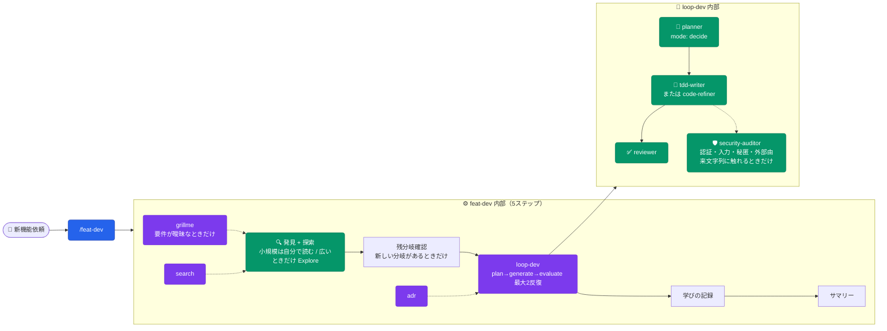

- **いつ**: 新機能・機能拡張・中規模リファクタ
- **効果**:
  - 探索→実装→レビューが自動でつながる。
  - セキュリティに触れる変更は security-auditor も当てる。
  - 実装は loop-dev が最大2反復で収束させる。
  - 先に探索するので、既存パターン無視や重複実装が起きにくい。

```bash
/feat-dev "ユーザー認証に 2FA を追加"
```

---

### バグ修正

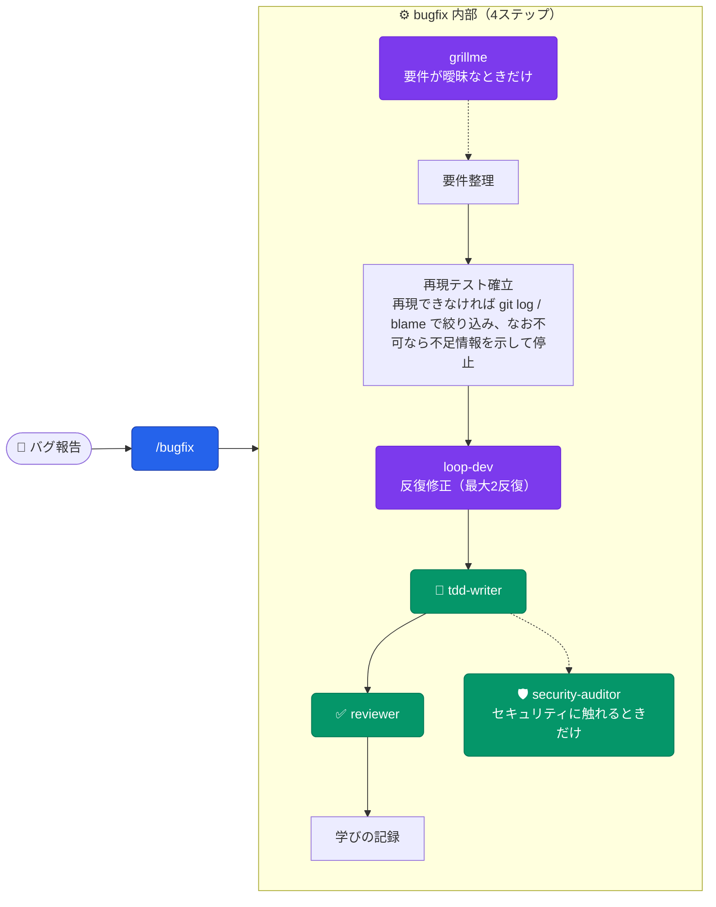

- **いつ**: バグ修正・不具合対応
- **効果**:
  - 再現テストを先に作るので、直したつもりが残らない。
  - 収束条件は「再現テスト green」と「回帰テスト追加済み」。

```bash
/bugfix "ログイン直後にダッシュボードが空になる" src/dashboard/
```

---

### フルリファクタリング

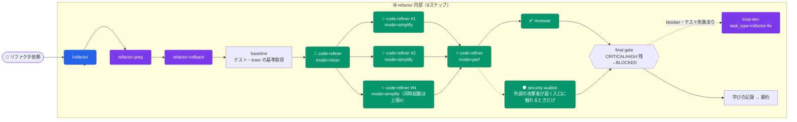

- **いつ**: 5 件以上のリファクタ・大規模なコード整理
- **効果**:
  - clean → simplify（並列）→ perf → review を自動でつなぐ。
  - 各段の失敗はファイル単位ですぐ戻す。
  - final gate に CRITICAL/HIGH が残れば loop-dev（`refactor-fix`）で解消を試みる。
  - それでも残れば BLOCKED。

```bash
/refactor src/auth/
```

---

### コード単純化のみ

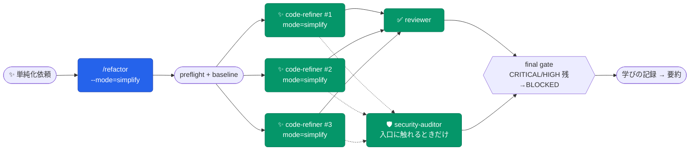

- **いつ**: 可読性・保守性だけを上げたい（機能変更なし）
- **効果**:
  - ファイルグループを並列で単純化する（同時起動は上限 4）。
  - clean / perf は飛ばす。
  - preflight・baseline・review・final gate・学びの記録・要約は省かない。

```bash
/refactor --mode=simplify src/api/
```

---

### デッドコード掃除

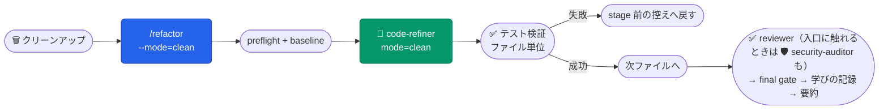

- **いつ**: 未使用コード・依存の削除
- **効果**:
  - 削除ごとにテストし、失敗したらすぐ戻す。
  - 全ファイル後に review と final gate を通す。

```bash
/refactor --mode=clean
```

---

### クイック往復モード

`quick-*` の 5 スキルは同じ設計です。
人間が実行と検証を担い、Claude Code は差分だけを返します。

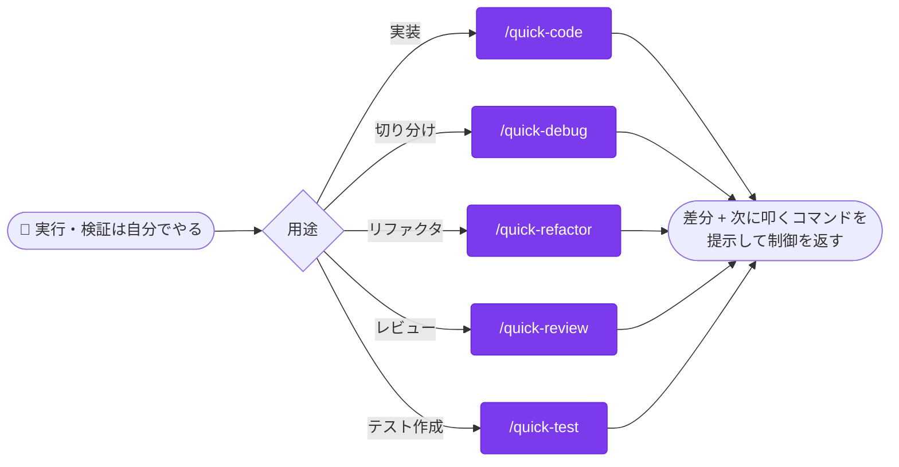

- **いつ**: 「実行は自分でやる」と明示したときだけ
  - `disable-model-invocation` なので自動発火しない。
- **効果**: 最小差分と次に叩くコマンドだけを返し、人間側の反復を速くする。
- **使い分け**:
  - `/quick-code`: 実装
  - `/quick-debug`: 切り分け（修正は当てない）
  - `/quick-refactor`: 振る舞いを変えない書き換え
  - `/quick-review`: 確定した指摘だけ適用
  - `/quick-test`: テストコードのみ

```bash
/quick-code "バリデーション追加" src/form.py
```

---

### テストコード自動生成

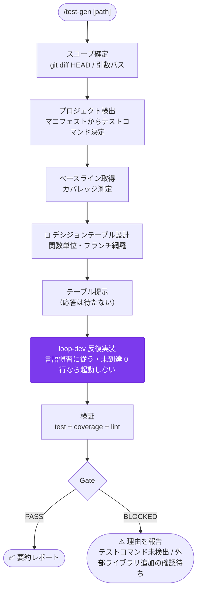

- **いつ**: テストの新規追加・カバレッジ補完
- **効果**:
  - デシジョンテーブルでブランチを網羅し、承認を待たず loop-dev が実装する。
  - 生成テストが落ちてもプロダクトコードは直さず報告する。仕様の不明点が見える。
  - 外部ライブラリが要るときだけ追加の可否を確認する。

```bash
/test-gen src/auth/login.py
```

---

### 依存更新

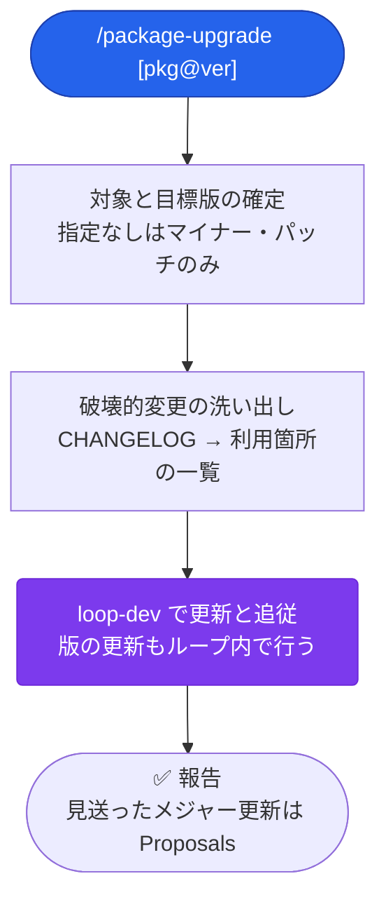

- **いつ**: 依存パッケージやランタイムの版上げ
- **効果**: 破壊的変更を利用箇所まで落としてから直す。テストが落ちる理由を探し回らずに済む。

```bash
/package-upgrade requests@3
```

---

### 性能改善

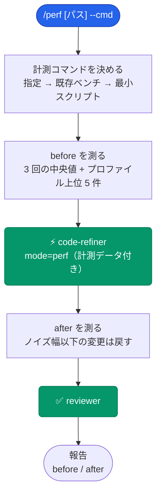

- **いつ**: 遅い処理を、数字で確かめながら速くしたい
- **効果**: 実測で効いた変更だけが残る。効かない最適化でコードが読みにくくならない。

```bash
/perf src/report/ --cmd "python3 scripts/bench_report.py"
```

---

## 品質・セキュリティ

### セキュリティ重視の実装

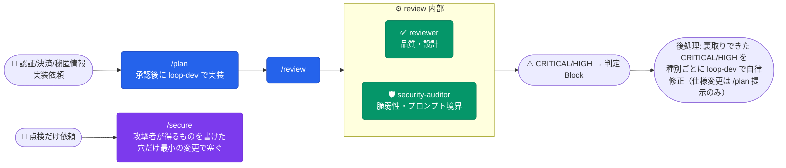

- **いつ**: 認証・決済・シークレット・API エンドポイントの実装
- **効果**:
  - reviewer が品質・設計を見る。
  - 外部の攻撃者が届く入口に触れるときは security-auditor も並列で見る。
  - CRITICAL/HIGH があれば判定は `Block`（コミット不可）。
  - 後処理で、実挙動から裏取りできた指摘だけを直す。
  - 点検だけなら `/secure` を使う。

```bash
/plan "決済モジュールに 3D セキュア対応を追加"
/review --base main
```

---

### 品質管理サイクル（定期メンテ）

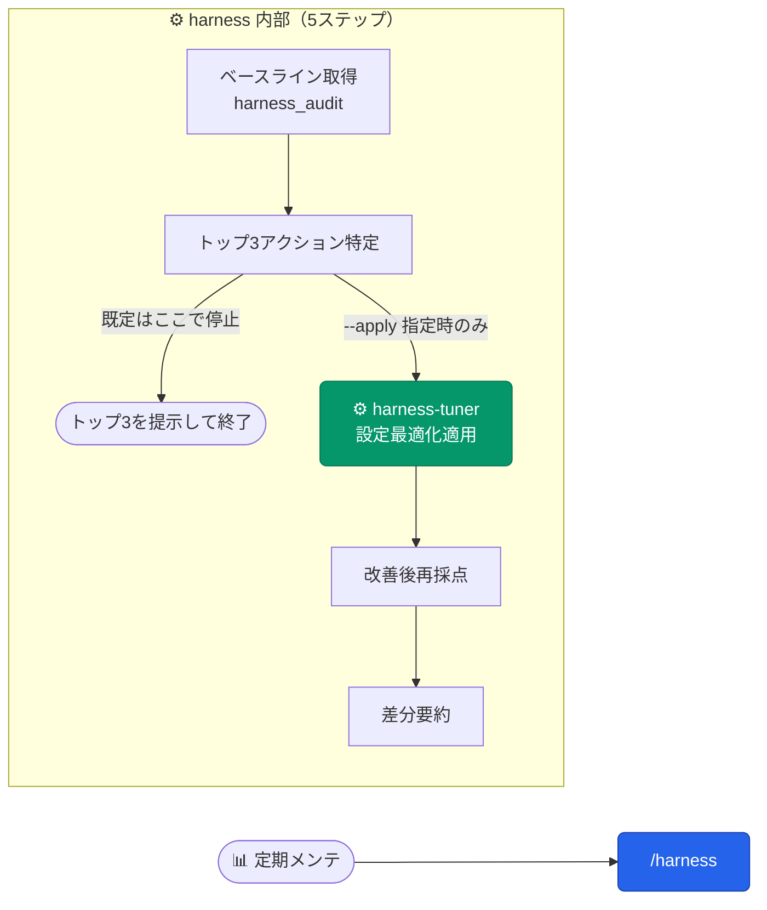

- **いつ**: 週次・月次の品質チェック
- **効果**:
  - 既定は自動採点してトップ3の改善案を出すまで。
  - `--apply` のときだけ harness-tuner が適用し、再採点で効果を確かめる。

```bash
/harness repo --root .           # 採点とトップ3の提示まで
/harness repo --root . --apply   # 適用と再採点まで
```

---

## スキル・知識管理

### スキル新規作成・改善

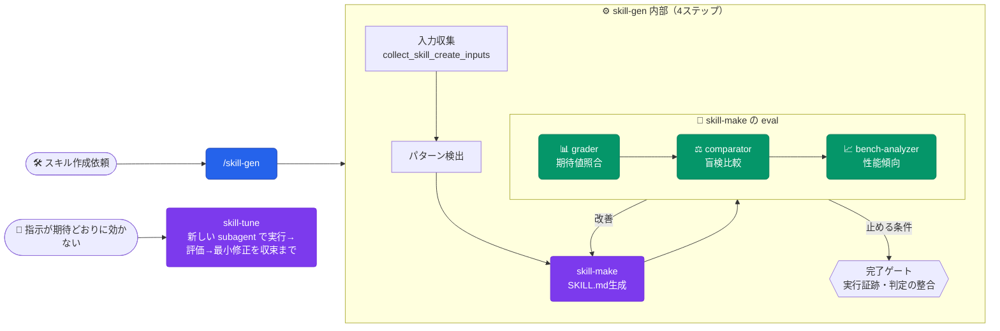

- **いつ**: 新スキルの作成・既存スキルの改善
  - 指示が期待どおりに効かないときは `skill-tune`。
- **効果**:
  - 生成→eval→ベンチマーク分析→改善が自動でつながる。
  - 新しい失敗も eval の改善案も出なくなったら止まる。
  - 完了ゲートが実行証跡と判定の整合を確かめる。
  - `skill-tune` は新しいサブエージェントに指示を実行させ、曖昧さを最小修正で潰す。

```bash
/skill-gen --commits=200 --knowledge
```

---

### 知識蓄積サイクル

各コマンドの最後にある「学びの記録」で知識カードが増えます。
command / skill が明示的に `claq_mem_learn` を呼びます。
定期実行や無操作での自動蓄積はありません。

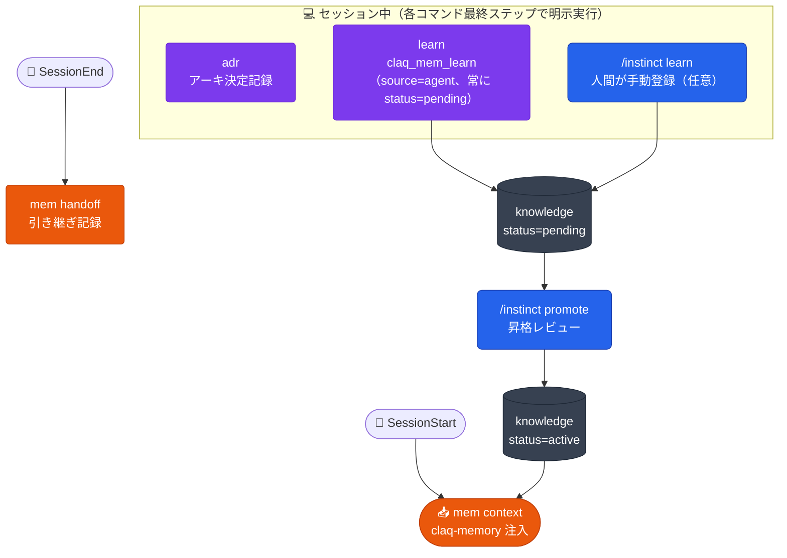

- **いつ**: 各コマンドの「学びの記録」ステップ（コマンド実行が前提）
- **効果**: 罠・規約・決定がカードとして残り、次のセッションへ注入される。
- **注入の条件**:
  - agent 由来カード（`claq_mem_learn`）は **常に** `status=pending` で入る。
  - `/instinct promote <key>` で昇格して初めて注入される。
  - `learn` に `--status` は無く、helper も CLI も指定を拒否する。
- **運用**: 週次で `/instinct list --status pending` を見て、採用分を `/instinct promote <key>`。

---

### ループ収束品質診断

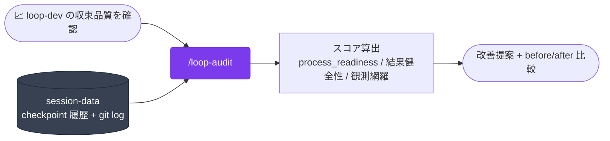

- **いつ**: loop-dev を使う開発（`feat-dev` / `bugfix` / `refactor` 等）の収束品質を振り返りたい
- **効果**:
  - checkpoint 履歴・git log など一次データだけで決定論的に採点する。
  - 工程充足・結果健全性・観測網羅を分けるので原因を切り分けやすい。

```bash
/loop-audit 2026-08-01 前後で比較
```

---

### 反復ループの中断復旧（自動）


- **いつ**: loop-dev 等の長い反復ループから自動で呼ばれる（直接呼ぶ想定はない）
- **効果**: 完了済み・残りのステップとベースラインを保存し、レート制限で止まっても速く再開できる。
- **操作**: 不要。

---

## 新規生成

テンプレートを複製してゼロから作ります。

### MCP サーバ新規構築

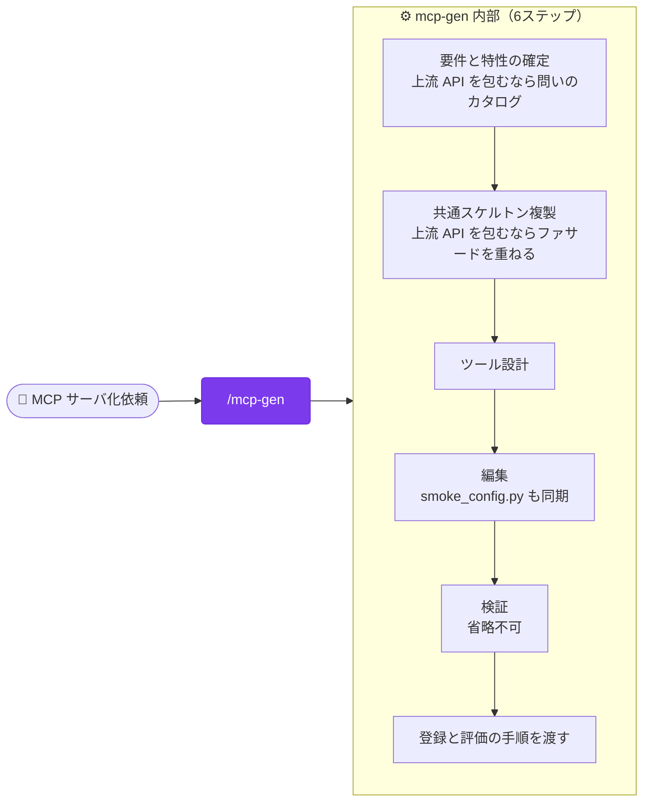

- **いつ**: 「MCP サーバを作って」「既存 API を MCP 化して」等
- **効果**:
  - 記憶で書かず、検証済みスケルトンを複製するので設定ミスが起きにくい。
  - 規模ではなく要件の特性で、重ねる骨格と読む規則を選ぶ。
    - 特性: 上流 API を包む・応答が入れ子で大きい・複数 API を結合する・リモート公開。
  - 実起動スモークで、仕様と設計規則への適合を確かめるまで進める。
    - 設計規則: 未知の引数の拒否・結果の大きさ・ページング。
- **対象外**: 既存サーバの単発修正は `/bugfix`、脆弱性レビューは `secure`。

```bash
/mcp-gen "Notion API を MCP 化"
```

---

### shadcn/ui サイト・ダッシュボード新規作成

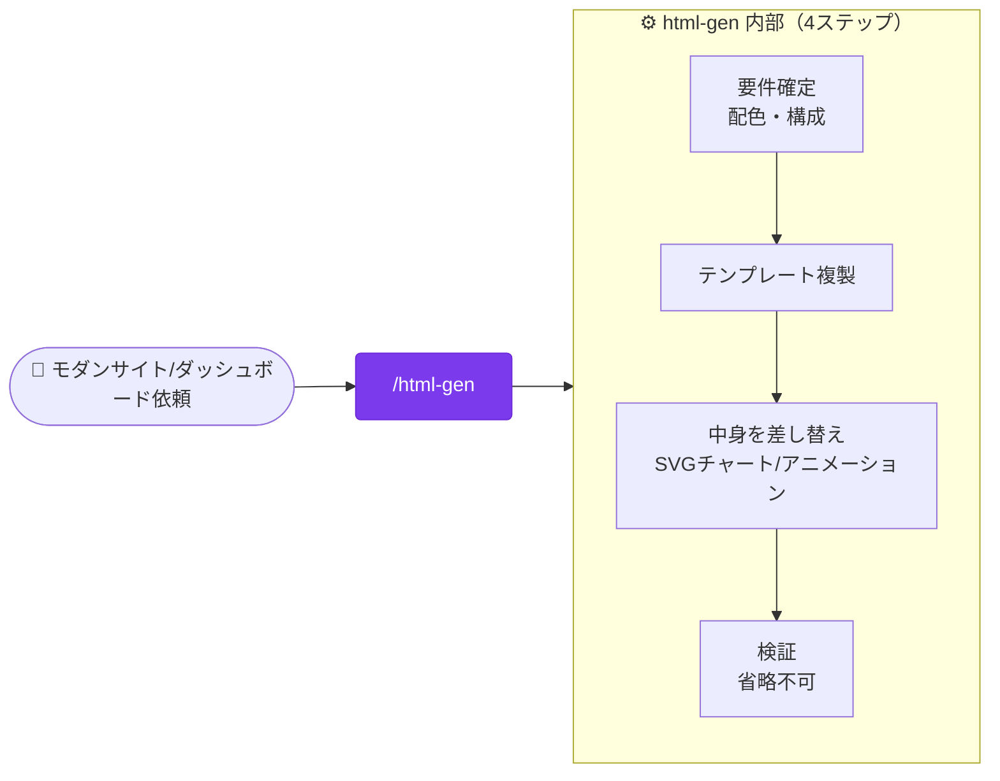

- **いつ**: 「shadcn でサイトを」「モダンな HTML ダッシュボードを作って」等
- **効果**:
  - 色を思い出しで書かず、shadcn/ui のトークンをテンプレートから複製する。
  - レスポンシブ（320〜1920px）とライト/ダーク切替が既定。
- **対象外**: 既存サイトの単発修正は `/bugfix`。

```bash
/html-gen "SaaS 管理画面ダッシュボード"
```

---

## 自動化

通常操作にフックして自動で動きます。

### Git ワークフロー支援（自動アドバイス）

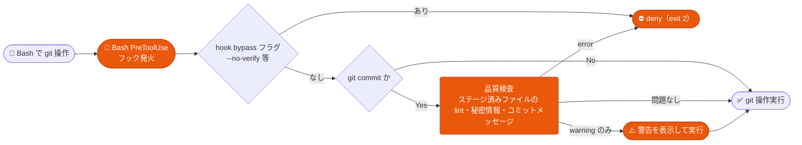

- **いつ**: Bash ツールでの git 操作（自動）
  - `--no-verify` 等の bypass 拒否は `commit` / `merge` / `rebase` / `push` などが対象。
  - 品質検査は `git commit` だけが対象。
- **効果**:
  - pre-commit・commit-msg・pre-push フックの握り潰しを防ぐ。
  - 壊れたファイルや秘密情報の混入をコミット前に止める。
  - warning は止めずに表示する。
- **操作**: 不要。普段どおり git を使う。

### 他の保護フック

- `config_protection`（Edit/Write 系）と `bash_config_protection`（リダイレクト・`tee`・`sed -i` 等）は次の書き換えを deny する。
  - linter / formatter の設定ファイル
  - `.git/hooks/` と、git config のフック無効化キー
  - claq 自身の `hooks.json` と実行中のランタイム（`runtime/`・`src/claq/`）
  - ホスト設定（`settings.json` の `hooks` / `enabledPlugins` 等）
  - 設定を弱めず、コードを直す方向へ導く。
- Bash から `~/.claq/logs/` への書込みも deny する。
  - ログの末尾が次の SessionStart に注入されるため。
- コミット品質検査は、同じ呼び出しで作業ツリーや index を変えてから `git commit` すると止める。
  - 変更と `git add` は別の呼び出しに分ける。
- `PreCompact` は圧縮の発生を `~/.claq/session-data/compaction-log.txt` に追記するだけ。止めない。

### 保護フックの保証範囲

- `block_no_verify` / `pre_bash_commit_quality` / `bash_config_protection` / `config_protection` は **best-effort な事故防止** です。
- **敵対的な回避を防ぐ壁ではありません**（[シェルコマンド解析の境界](docs/adr/shell-analysis-boundary.md)）。
- 次の経路は、意図的に検出しません。
  - シェルエイリアス・シェル関数
  - 変数展開・コマンド置換
  - 2 段以上の `sh -c` / `eval`
  - `git` 以外の名前のラッパースクリプト
- 理由: POSIX シェルの意味は実行時環境で決まり、静的解析では再現できないため。
- 回避を防ぐ必要があるなら、サーバ側の検証（受信 commit の署名・テスト・policy 適合）で担保してください。

---

## 🏗️ Architecture

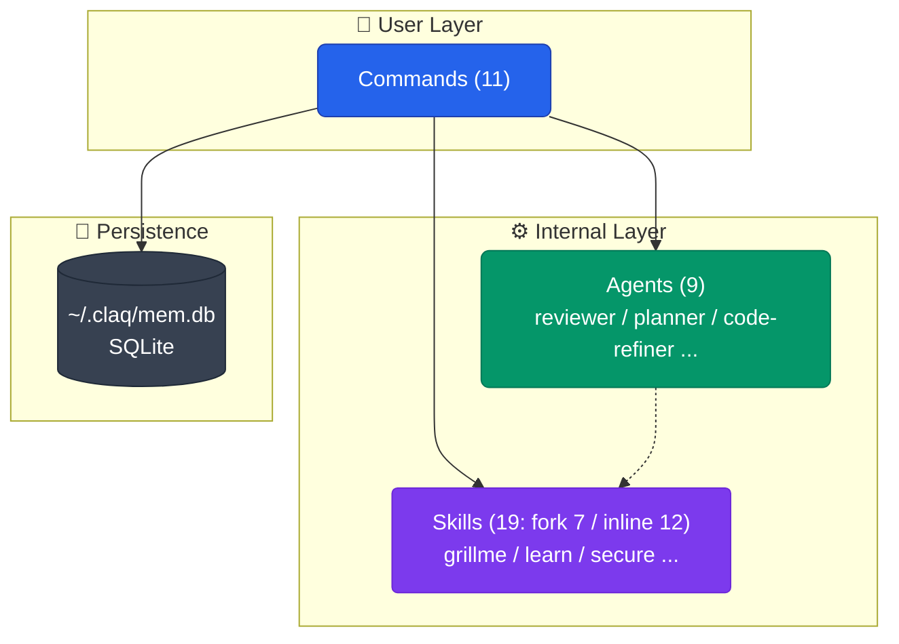

**設計方針**

- ユーザーは **Commands だけ選べば**、内部で Agents / Skills が自動でつながる。
- `context: fork` は、次をすべて満たす skill だけに付ける。
  - ツール消費が報告より重い。
  - ユーザーの応答も、本文自体も親に要らない。
  - 理由: fork は対話・承認ゲートを持てず、既定でバックグラウンド実行されるため。
  - 結果が呼び出し側の次の手順を決める skill は `background: false` を書く。
- 対話・承認を伴う skill、本文や出力が親の判断材料になる skill は inline。
- ユーザーが直接呼べるかは `user-invocable` で別に決める。
- 永続化は **SQLite（個人）** の単層。テーブルは `repos` / `knowledge` / `sessions` の 3 つだけ。
- 検索は埋め込みも FTS5 も使わず、Python 側で採点する（ランタイム依存は標準ライブラリのみ）。
- 知識カードを書くのは Commands / Skills の「学びの記録」だけ。Agents は書かず、候補を呼び出し元へ返す。

各コマンドの詳細は [`plugins/claq/commands/`](plugins/claq/commands/) を参照してください。

---

## 📚 ドキュメント

| 場所 | 内容 |
|---|---|
| [`docs/adr/`](docs/adr/README.md) | 現在有効な設計判断の基準。役割ごとに 1 ファイル |
| [`.claude/skills/`](.claude/skills/) | claq 自身の開発用スキル（配布しない）。`maintain`（定期メンテ）と `release-verify`（リリース前の実起動検証） |
| [`docs/specs/`](docs/specs/multi-api-mcp-design.md) | 複数の複雑な API から読み取り専用で取得する MCP サーバの設計方針（`mcp-gen` のファサードの根拠） |
