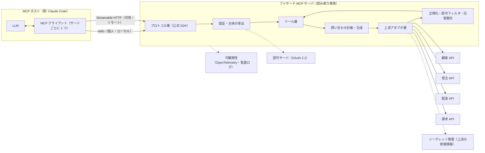
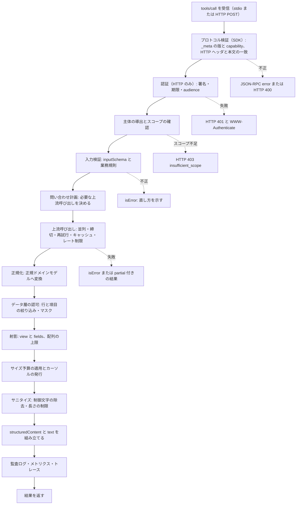
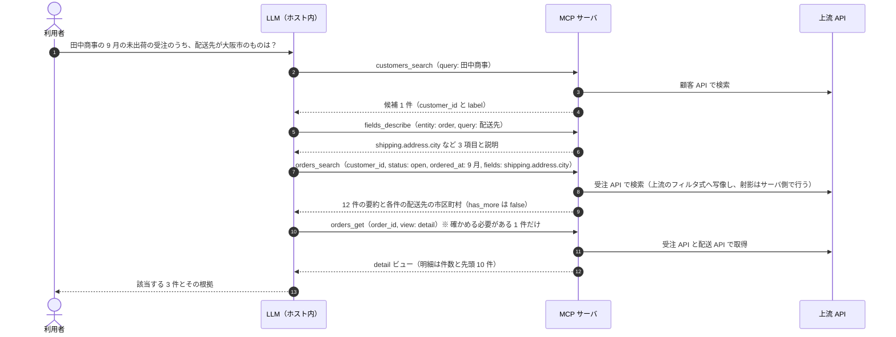
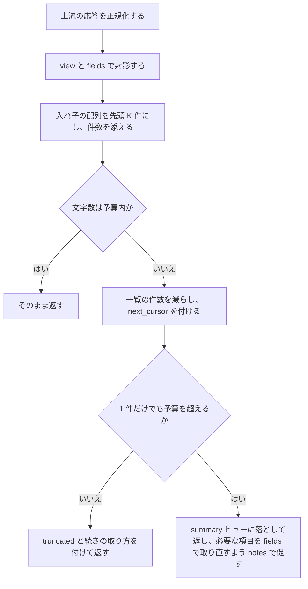
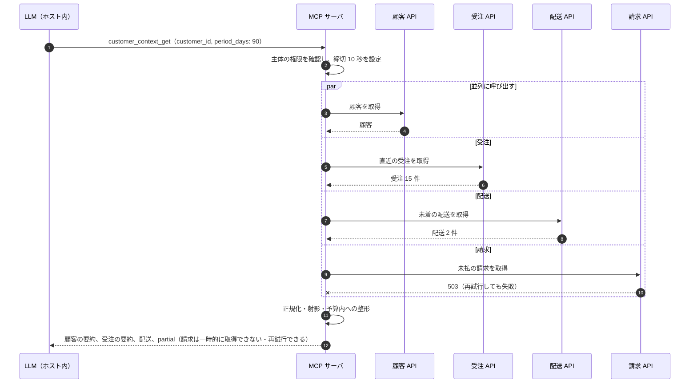
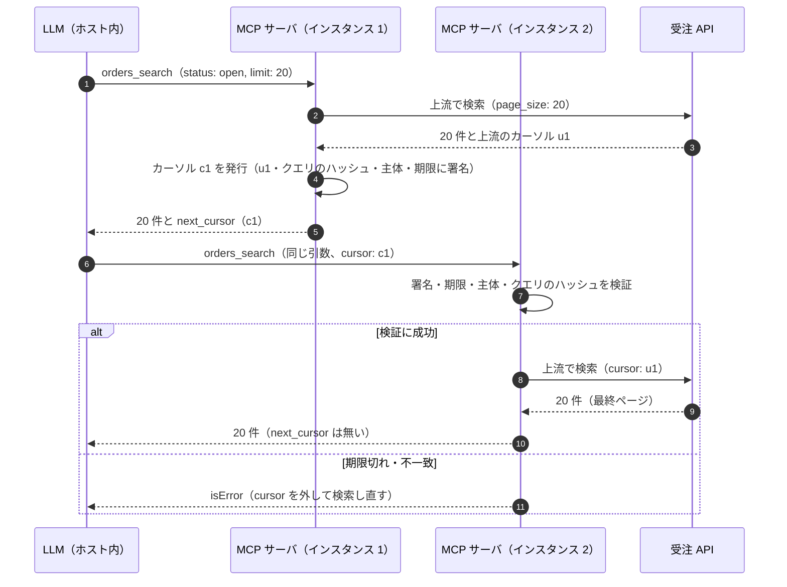
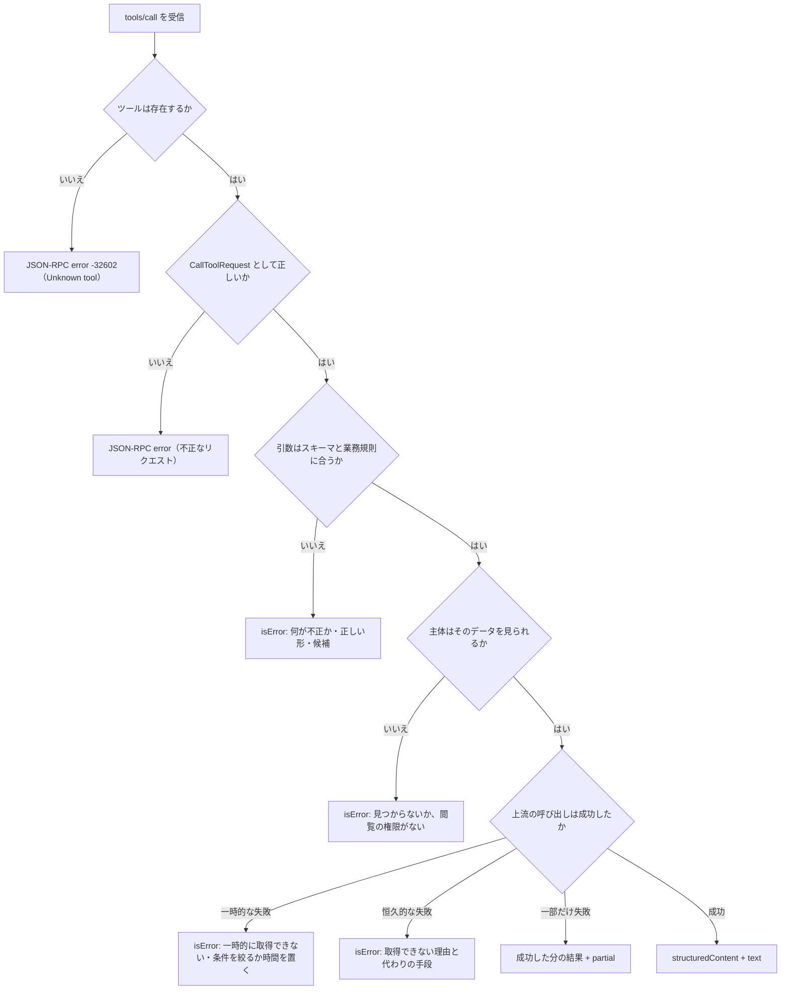
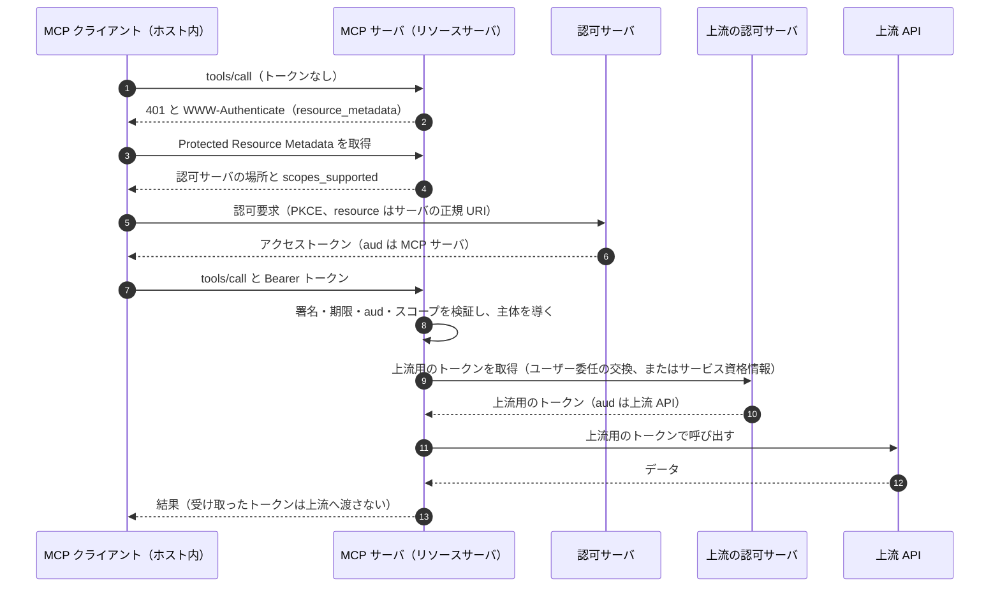
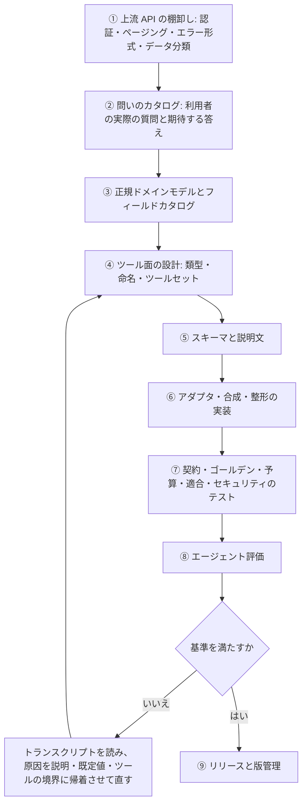

# 複数の複雑な API からデータを取得する MCP サーバ 設計概要書

## 0. 文書の位置づけ

| 項目 | 内容 |
|---|---|
| 目的 | 入出力が複雑な API（深い入れ子・数百の field・多数の任意パラメータ）を複数持つシステムから、LLM エージェントが正確・効率的・安全にデータを取得するための MCP サーバの設計方針を定める |
| 範囲 | 読み取り専用。書き込みは対象外（§3.3） |
| 準拠する仕様 | MCP 2026-07-28（2026-10-03 時点の current。2025-11-25 からの破壊的改訂でステートレス化された版） |
| 起点 | Gemini による概要設計メモ（本リポジトリには含まれない）。検証対象の仮説として扱い、§2 で精査する |
| 調査日 | 2026-10-03 |
| 例示ドメイン | 架空の受注システム。顧客 API・受注 API・配送 API・請求 API の 4 つで、認証方式・ページング方式・エラー形式・日付形式がそれぞれ異なる。受注 API の応答は明細・割引・税・配送先・支払を含む深い入れ子で、数百の field を持つ |

### 根拠の種別

主張には根拠の種別を付ける。仕様の規範と、ベンダーの知見や本書の判断を取り違えないためである。

| タグ | 意味 |
|---|---|
| 【仕様】 | MCP 2026-07-28 の本文と schema.ts の規範。MUST / SHOULD / MAY は仕様の用語のまま示す |
| 【公式ガイド】 | modelcontextprotocol.io の非規範文書（Security Best Practices、Client Best Practices、公式ブログ、SEP など） |
| 【ベンダー】 | 特定ベンダーや特定ホストの記事・実装値（Anthropic Engineering、Claude Code ドキュメント）。他のホストでは成り立たないことがある |
| 【実測】 | このリポジトリで公式 Python SDK を実行して得た挙動（[sdk-api-evidence.md](../../plugins/claq/skills/mcp-gen/references/sdk-api-evidence.md)） |
| 【判断】 | 本書の設計判断。理由は本文に書く |

### 結論の要約

1. メモの骨格（3 層分離、ドメイン分散のマイクロ MCP、HTTP+SSE を主とするトランスポート、Prompts / Resources による手順の注入）は、いずれも現行仕様・本要件・ホストの実態のどれかと合わない。採用しない（§2）。
2. 対象システム 1 つにつき、ファサード MCP サーバを 1 つ置く。上流 API の複雑さはサーバの中で吸収し、モデルには「問い」に合わせた少数の読み取り専用ツールだけを見せる（§5, §6）。
3. 入れ子が深く field の多い応答は、正規ドメインモデルに正規化したうえで段階的に開示する。既定は summary ビューで返し、必要な項目だけを `fields` で指定させ、項目の意味は `fields_describe` で引かせる。全項目の一括返却はしない（§8）。
4. 文脈の予算を設計上の制約として扱う。ツールごとにサイズ予算・配列の上限・ページングを持たせ、件数や合計はサーバで集計する（§8, §10）。
5. 2026-07-28 のステートレス性に合わせ、ページングは自己完結したカーソルで行う。どのインスタンスでも続きを返せる。共有のリモート（複数の主体）では署名・主体への束縛・有効期限を足す（§10）。
6. 読み取り専用は、注釈ではなく上流資格情報のスコープで強制する。受け取ったトークンは上流へ渡さず、上流には別のトークンを使う（§12）。
7. ツール説明・スキーマ・既定値は、実際の問いを集めたエージェント評価で改善する（§14）。

### 図一覧

| 図 | 内容 | 節 |
|---|---|---|
| 図1 | 全体構成 | §5.1 |
| 図2 | エージェントの典型的な取得シーケンス | §6.7 |
| 図3 | `tools/call` の内部処理パイプライン | §5.3 |
| 図4 | 複数 API 合成のファンアウトと部分失敗 | §9.2 |
| 図5 | 署名付きカーソルによるページング | §10.2 |
| 図6 | 応答サイズの制御 | §8.4 |
| 図7 | エラーの分類 | §11.1 |
| 図8 | リモート配置の認可と上流用トークン | §12.2 |
| 図9 | 構築プロセスと評価・改善ループ | §16 |

## 1. メタ認知（作業前の自己点検）

### 1.1 自覚したバイアスと対処

| バイアス | 起きうること | 対処 |
|---|---|---|
| メモの枠組みへの係留 | 3 層分離やドメイン分散を骨格として流用し、細部の修正だけで済ませる | メモを主張の一覧に分解し、1 件ずつ一次資料で判定する（§2） |
| 学習済みの古い MCP 知識 | `initialize`・セッション・HTTP+SSE を前提に書く | 2026-07-28 の仕様本文と schema.ts を取得し、取得した記述だけを根拠にする |
| ベンダー情報の規範化 | Anthropic の推奨値や Claude Code の上限を、仕様の規範のように書く | 根拠に種別タグを付け、ホスト固有の値には依存しない設計にする |
| 要約の誤読 | 取得ツールが返す要約を原文と取り違える | 規範は言い換えとリンクで示し、MUST / SHOULD は仕様ページで確かめたものだけを書く |
| 「API ごとに 1 ツール」の定型 | OpenAPI から機械的にツールを生やす | ツールは問いから設計する、という原則を先に立てる（§4 P1） |
| 両論併記 | 選択肢を並べ、判断を読者に委ねる | 論点ごとに「決定 / 根拠 / 却下案」で立場を 1 つに絞る |
| 過剰設計 | ゲートウェイ・拡張・サンドボックスを全部載せる | 何のために要るかを説明できないものは §17 の不採用に回す |

### 1.2 依頼の前提への指摘

メモは「LLM が当て推量で API を実行し、システムを破壊する」ことを中心の課題に置いている。しかし本依頼の目的はデータの**取得**であり、中心の課題は次の 3 つである。

- 正確さ: 曖昧な指示から、正しい対象と正しい項目にたどり着けるか
- 効率: 入れ子が深く field の多いデータを、モデルの文脈を溢れさせずに渡せるか
- 安全: 見せてよいデータだけを、見せてよい相手に返せるか

課題の設定がずれた結果、メモは承認フローや手順の注入といった書き込み向けの対策に紙幅を割く一方で、応答の整形・段階開示・サイズ予算・ページングという本題がほぼ抜け落ちている。本書はこのずれを正してから設計する。

## 2. Gemini メモの精査

判定の凡例: 正しい / 部分的に正しい / 誤り / 標準外（仕様が標準として定めていない）/ ホスト依存（ホストの実装次第で成り立ち、前提にはできない）/ 範囲外（本要件の対象外）/ 用語誤り

| # | メモの主張（節） | 判定 | 根拠 | 本書での扱い |
|---|---|---|---|---|
| 1 | MCP は JSON-RPC 2.0 ベース（1.1） | 正しい | 全てのメッセージは JSON-RPC 2.0 に従わなければならない（MUST）【仕様】 | そのまま |
| 2 | 「最新の MCP 標準仕様に基づく」（1.1） | 誤り | 現行は 2026-07-28。`initialize` ハンドシェイク、`Mcp-Session-Id`、GET の SSE ストリーム、サーバ発のリクエストを廃止し、各リクエストの `_meta` が版と capability を運ぶ形になった【仕様】。メモはこれらに触れておらず、2025 年以前の形で書かれている | 2026-07-28 を前提に全面的に書き直す |
| 3 | 当て推量による破壊のリスクを排除する（1.1） | 範囲外 | 本要件は取得だけを扱う。また「排除」はプロンプトでは保証できず、資格情報と入力検証でしか強制できない【判断】 | 読み取り専用を上流資格情報のスコープで強制する（§12） |
| 4 | 手順 → 検索 → 実行の 3 層に厳格に分離する（1.1, 3） | 部分的に正しい | 読みと書きを分けるのは最小権限として妥当【判断】。ただし実行層は範囲外で、手順層は実現手段（#11, #12）が成り立たず、層の順序を守らせる仕組みも無い | 層ではなく「ツールの類型」（§6）と「ガイダンスの経路」（§5.4）で組み直す |
| 5 | ドメインごとのマイクロ MCP サーバで、コンテキストの肥大化を防ぐ（2） | 部分的に正しい | 成り立つのは、ホストがサーバを必要なときだけ接続し、不要になったら切断する場合に限られる（サーバ単位の動的な接続は公式ガイドに例示がある）【公式ガイド】。接続した全サーバの定義をモデルに渡すホストでは、サーバを分けても合計は減らない。定義量の抑制は、本来ホスト側の段階的発見で行うもので、切り替えの閾値には文脈窓の 1〜5% が例示されている【公式ガイド】。また分割すると、API をまたぐ結合をモデルが担うことになり、呼び出し回数と誤りが増える。1 つのサーバの中でも、ツールセットを設定やスコープで切り替えれば同じ制御ができる【判断】 | 分割の基準を信頼境界・資格情報・運用主体に限る（§5.1） |
| 6 | 手順（Prompts / Resources）を Shared Flow サーバに集める（2） | 誤り | 手順と、それが説明するツールとで、版や配布が分かれてしまう。Skills 拡張の SEP も、サーバとその使い方の配布が分断されることを問題として挙げている【公式ガイド】 | ガイダンスはツールと同じサーバに置く（§5.4） |
| 7 | HTTP（サーバ→クライアントは SSE、クライアント→サーバは POST）を主トランスポートにする（2.1） | 誤り | この形は 2024-11-05 の HTTP+SSE である。2025-03-26 で Streamable HTTP に置き換えられ、2026-07-28 では Deprecated に分類された。新規の実装は採用すべきでない（SHOULD NOT）【仕様】 | Streamable HTTP を使う（§5.2） |
| 8 | HTTP は API ゲートウェイ・ロードバランサ・認証プロキシと親和性が高い（2.1） | 部分的に正しい | それを実現したのは 2026-07-28 の Streamable HTTP である。セッションが無いのでどのインスタンスでも処理でき、`Mcp-Method` / `Mcp-Name` ヘッダで本文を読まずに振り分けられる【仕様】。メモの HTTP+SSE は長命の接続を要し、ロードバランサとはむしろ相性が悪い。また前段の認証プロキシだけでは足りず、MCP サーバ自身がトークンの audience を検証しなければならない（MUST）【仕様】 | §5.2, §12.2 |
| 9 | stdio はサブ・ローカル検証用（2.1） | 部分的に正しい | stdio はローカル配置の第一選択であり、検証専用ではない。ローカルで動かすサーバは他のプロセスからの不正利用を防ぐ手段を講じるべき（SHOULD）で、その手段の筆頭に stdio が挙げられている【公式ガイド】。認可仕様は stdio には適用せず、資格情報は環境から取る（SHOULD）【仕様】 | 個人・ローカル配置の標準とする（§5.2） |
| 10 | WebSocket に拡張対応する（2.1） | 標準外 | 標準のトランスポートは stdio と Streamable HTTP の 2 つ。カスタムトランスポートは許される（MAY）が、相互運用は保証されない【仕様】。Claude Code は `type: "ws"` を持つが、OAuth には対応しない【ベンダー】。挙げられた理由（SSE がプロキシのタイムアウトで切れる）は、2026-07-28 で SSE がリクエスト単位になり、`X-Accel-Buffering: no` とキープアライブが推奨されたことで解消の方向にある【仕様】 | 採用しない（§17） |
| 11 | LLM が `resources/list` で一覧を取り、`resources/read` で読み込む（3） | ホスト依存（前提にできない） | Resources はアプリケーション主導で、文脈への入れ方はホストが決める。モデルの選択による自動取り込みも許される実装の 1 つだが、UI での明示的な選択など別の形もある【仕様】。モデルが自律的に読むことを前提にはできない | コア機能を Resources に載せない（§5.4） |
| 12 | Prompts で開始時のワークフローを示し、「必ず Search で確認し、承認を得ること」と指示する（3） | 誤り | Prompts はユーザー制御で、利用者がスラッシュコマンドなどで明示的に選ぶもの【仕様】。モデルに自動では入らず、入ったとしても強制力は無い。server instructions も、決定的な実行が要るセキュリティ上の制御には使うべきでないとされる【公式ガイド】 | 横断のガイドは `instructions` とツール説明に書き、不変条件はサーバのコードで強制する（§5.4） |
| 13 | OpenAPI Summary やドメインマニュアルを Resource として公開する（3） | 誤り寄り | モデルは生の API を呼べないのに、生の API の語彙（パス・包み・内部コード）を覚えさせることになり、文脈も消費する【判断】 | 正規化済みのフィールドカタログを `fields_describe` で必要な分だけ返す（§8.2） |
| 14 | ツール定義は JSON Schema 2020-12 dialect に準拠する（3） | 正しい | `$schema` が無ければ 2020-12 として扱われる【仕様】。2026-07-28 で、inputSchema と outputSchema は 2020-12 の任意のキーワードを使えるようになった【仕様】 | そのまま。ただし使うキーワードは絞る（§7.1） |
| 15 | 入力パラメータはフラットに抽象化する（3） | 部分的に正しい | 浅くする・名前を明確にする・列挙を使う方向は正しい【ベンダー】。ただし一律の平坦化は誤り。期間（from / to）のように組で意味を持つ構造は、1 段の入れ子にしたほうが誤用が少ない【判断】 | 入れ子は 2 段まで（§7.1） |
| 16 | `search_entities` / `get_entity_status`（3） | 部分的に正しい | 曖昧な語から ID を解決して取得する流れは妥当で、「一覧より検索」という推奨にも合う【ベンダー】。しかし `entities` では何を探すツールか分からず、ツールの選択を誤らせる | リソース名を冠した命名にする（§6.3） |
| 17 | `execute_multi_api_sync`: 複数の API を順次・並列に呼び、結果をマージする高レベルのツール（3） | 部分的に正しい | API の結合をサーバ側で行う方向は正しい。API を包むだけのツールより、関連データをまとめて返すツールが推奨されている【ベンダー】。ただし本要件では読み取りの合成として作り、書き込みと混ぜない。`execute`・`multi_api`・`sync` は実装の語彙で、何が返るかを伝えない | `customer_context_get` 型の文脈合成ツールにする（§6.1） |
| 18 | スキーマ例の `"\$schema": "https://json-schema.org"`（4） | 誤り（2 点） | `\$` は JSON の有効なエスケープではなく、この例は JSON として解析できない。また、URI がメタスキーマを指していない（2020-12 なら `https://json-schema.org/draft/2020-12/schema`） | `$schema` は書かない。省略すれば 2020-12 になる【仕様】 |
| 19 | `"format": "uuid"`（4） | 部分的に正しい | 2020-12 では `format` は既定で注釈であり、検証器はアサーションとして扱わないのが既定【JSON Schema 2020-12】。モデルへの説明にはなるが、検証にはならない | `pattern` とサーバ側の検証で担保する（§7.1） |
| 20 | `"update_payload": {"type": "object"}`。生の API の入れ子はサーバで組み立てる（4） | 誤り | 項目が定義されていない自由形式で、メモ自身の「厳格な引数定義」と矛盾する。モデルはキー名を推測するしかなく、メモが避けたい当て推量そのものになる | 項目を列挙し、`additionalProperties: false` にする（§7.1）。更新ツール自体は範囲外 |
| 21 | 説明文の「事前に必ず `search_entities` で正しい UUID を取得した上で実行」（4） | 部分的に正しい | 使い方の誘導として説明に書くのは有効【ベンダー】。ただし強制力は無い | 未知の ID には、検索ツールで特定するよう指示する `isError` を返す（§11） |
| 22 | トークンパススルーの禁止と認証の隠蔽（5.1） | 正しい（定義はずれている） | 仕様の言うトークンパススルーは、「自分宛に発行されたことを検証せずにクライアントのトークンを受け入れ、下流へそのまま渡すこと」【公式ガイド】。MCP サーバは自分宛でないトークンを受け入れてはならない（MUST NOT）。上流 API には上流の認可サーバが発行した別のトークンを使い、受け取ったトークンを渡してはならない（MUST NOT）【仕様】。メモの「生のトークンや API キーを LLM 側に渡さない」はこれとは別の原則（これも正しい） | 2 つを別の項目として扱う（§12.2, §12.3） |
| 23 | 入力のバリデーションとサニタイズ（5.2） | 正しい（不足あり） | サーバは全てのツール入力を検証しなければならない（MUST）【仕様】。不足しているもの: 出力のサニタイズ（これも MUST）【仕様】、入力検証エラーを `isError: true` のツール実行エラーとして返し、モデルに自己修正させる規約【仕様】、上流データを経由したプロンプトインジェクションへの対策 | §7, §11, §12.6 |
| 24 | Human-in-the-Loop: 実行前に必ず人間が承認する（5.3） | 部分的に正しい | 人がツールの呼び出しを拒否できるべきで（SHOULD）、確認 UI はアプリケーション（ホスト）の責務【仕様】。サーバからは強制できず、ツール注釈も、信頼できるサーバのものでない限りクライアントは信頼してはならない【仕様】。読み取り系では、何を見せるかの最小化がサーバ側の主な対策になる | §12.5 |
| 25 | レートリミットとタイムアウト（5.4） | 正しい（不足あり） | サーバはツール呼び出しをレート制限しなければならない（MUST）。クライアントはタイムアウトを実装すべき（SHOULD）【仕様】。不足しているもの: 上流 API の保護（同時実行の制限・遮断器・クォータの共有）と、応答サイズの上限 | §8.4, §9.3, §9.5 |
| 26 | 図の「MCP Host (LLM Client)」（2） | 用語誤り | Host は AI アプリケーションであり、接続するサーバごとに Client を 1 つずつ作る。Host と Client は別のもの【公式ガイド】 | 図1 で区別して描く |
| 27 | （欠落） | — | ステートレス性と状態の受け渡し、outputSchema と structuredContent、応答の整形と段階開示、ページング、キャッシュヒント、`tools/list` の決定的な順序、エラーの規約、可観測性、評価、非推奨機能（Roots・Sampling・Logging など）の回避 | §5〜§15 |

## 3. 要件と前提

### 3.1 機能要件

| ID | 要件 |
|---|---|
| F1 | 曖昧な指示（名前・部分一致・期間・状態）から、対象のレコードを特定できる |
| F2 | 特定したレコードについて、入れ子の深い部分や多数の field のうち、必要な部分だけを取得できる |
| F3 | 複数の API にまたがる関連データを、1 回の呼び出しでまとめて取得できる |
| F4 | 件数・合計・内訳などの集計結果を、全件をモデルに読ませずに得られる |
| F5 | 大量の結果を、モデルの文脈を溢れさせずに順に辿れる |
| F6 | 利用できる項目と、その意味・単位・機微区分を調べられる |

### 3.2 非機能要件

| ID | 要件 | 測り方 |
|---|---|---|
| N1 正確性 | 正しいツールと正しい引数を選べる | エージェント評価の正答率（§14） |
| N2 トークン効率 | ツール定義と結果の合計が小さい | `tools/list` の大きさ、結果の文字数の分布 |
| N3 応答時間 | ホストのタイムアウト内に返る | ツール別の p95 遅延 |
| N4 上流の保護 | 上流の契約にクォータ・同時実行の上限があるとき、それを超えない | 上流別の 429 の発生数 |
| N5 安全性 | 見せてよい相手に、見せてよいデータだけを返す | セキュリティテスト、監査ログ |
| N6 移植性 | コア機能が tools と text content だけで成り立つ | Resources・Prompts・拡張を使わないホストでの評価 |
| N7 運用性 | 障害を追跡でき、ツールの契約を安全に変えられる | トレース、版管理の手順（§13, §15） |

### 3.3 スコープ外

- 書き込み（作成・更新・削除）。必要になったら、別の資格情報と別のツールセット（または別のサーバ）として設計する。読み取り用の資格情報に書き込み権限を足すことはしない【判断】。
- 上流 API そのものの改修。
- ホスト側の機能（ツール検索、code mode、確認 UI）の実装。サーバは、それらと相性の良い形を取るだけにする。

### 3.4 前提

- 上流 API は HTTP ベース（REST・GraphQL など）で、認証方式は API ごとに異なりうる。OpenAPI などの機械可読な定義があれば利用する。
- 主な利用者は汎用エージェントのホスト（例: Claude Code）である。ホスト固有の値は【ベンダー】として示し、他のホストでは確かめ直す。

## 4. 設計原則

| ID | 原則 | 根拠 |
|---|---|---|
| P1 | ツールは API のエンドポイントではなく、エージェントが答える「問い」に合わせる。API を包むだけのツールは作らない | API を包むだけのツールは典型的な失敗で、関連する操作をまとめた高水準のツールが有効とされる【ベンダー】 |
| P2 | MCP サーバは上流の複雑さ（認証・ページング方式・入れ子・コード値・API 間の結合・エラー形式）を吸収するファサードとし、モデルには小さく安定した契約だけを見せる | 【判断】 |
| P3 | 読み取り専用は、注釈ではなく資格情報で強制する | ツール注釈はヒントであり、信頼できるサーバのものでない限りクライアントは信頼してはならない【仕様】 |
| P4 | 文脈の予算を設計上の制約として扱う。既定の応答は簡潔にし、詳細は求めに応じて段階的に開示する | 【ベンダー】【公式ガイド】 |
| P5 | 契約を先に決める。正規ドメインモデルを定め、入出力のスキーマとフィールドカタログをそこから導く | 【判断】 |
| P6 | 失敗は、モデルが読んで直せる形で返す | 入力検証・業務・上流の失敗は `isError` で返し、モデルの自己修正に使わせる【仕様】 |
| P7 | ステートレスにする。接続やプロセスを会話とみなさず、呼び出しをまたぐ状態は明示的な識別子で受け渡す | 【仕様】 |
| P8 | 上流から来た文字列は、指示ではなくデータとして扱う | 他のサーバのツール結果は信頼できない入力とされる【公式ガイド】 |
| P9 | コア機能は tools と text content だけで成り立たせ、ホストに依存する機能は上乗せに留める | Resources・Prompts・拡張の扱いはホストごとに異なる【判断】 |
| P10 | ツール説明・スキーマ・既定値は、現実の問いを使ったエージェント評価で改善する | 評価駆動の改善手順が推奨されている【ベンダー】 |

## 5. アーキテクチャ

### 5.1 トポロジー

**決定**: 対象システム 1 つにつき、ファサード MCP サーバを 1 つ置く。次のいずれかに当たる場合に限って分割する。

- 資格情報や信頼境界が異なる（例: 社外の SaaS と社内の基幹システム、機密区分の異なるデータ）
- 運用の主体やリリースの周期が異なる
- 配置の場所が異なる（ローカルでの実行が必須のものと、共有のリモート）

**根拠**:

- 定義の量はサーバの数ではなく、ツールの数と定義の大きさで決まる。量の抑制はホスト側の段階的発見で行うもの【公式ガイド】。サーバ単位で必要なときだけ接続するホストもあるが、ホストに依存するので設計の前提にはしない【判断】。
- API 間の結合をサーバの中で行えば、モデルの呼び出し回数と文脈の消費が減る【ベンダー】。
- ツール名の一意性はサーバの中でしか保証されず、複数のサーバ間での衝突の回避はクライアントの責務とされている【仕様】。サーバを増やすほど、似た名前のツールが並ぶ。

**却下**: 上流 API ごと・ドメインごとのマイクロ MCP サーバ。結合をモデルに押し付け、文脈も減らない。

図1 全体構成



### 5.2 トランスポート

**決定**:

| 配置 | トランスポート | 認証・資格情報 |
|---|---|---|
| 共有・複数の利用者（組織内の共有サービス） | Streamable HTTP | OAuth 2.1 のリソースサーバとして実装する（§12.2） |
| 個人・ローカル（利用者自身の資格情報で動かす） | stdio | 認可仕様には従わず、環境変数または OS のキーチェーンから取る【仕様】 |

**根拠**: 標準のトランスポートはこの 2 つである【仕様】。Streamable HTTP はステートレスで、どのインスタンスにも振り分けられる【仕様】。stdio はそのサーバを起動したクライアントしか使えず、ローカルの他のプロセスから叩かれない【公式ガイド】。

**却下**: HTTP+SSE（Deprecated）、WebSocket（標準外）。

守るべき仕様上の要件:

| 対象 | 要件 | 種別 |
|---|---|---|
| Streamable HTTP | `Origin` ヘッダを検証し、不正なら 403 を返す | MUST【仕様】 |
| Streamable HTTP | ローカルで動かすときは 127.0.0.1 だけにバインドする | SHOULD【仕様】 |
| Streamable HTTP | 全ての接続を認証する | SHOULD【仕様】 |
| Streamable HTTP | `MCP-Protocol-Version`・`Mcp-Method`・`Mcp-Name` ヘッダが本文と一致しなければ、400（`-32020` HeaderMismatch）で拒否する | MUST【仕様】 |
| Streamable HTTP | この版だけを実装するサーバは、旧クライアントからの GET と DELETE に 405 を返す | SHOULD【仕様】 |
| Streamable HTTP | SSE で応答するときは `X-Accel-Buffering: no` を付ける | SHOULD【仕様】 |
| stdio | stdout には MCP メッセージ以外を書かない。メッセージは改行で区切り、内部に改行を含めない | MUST【仕様】 |
| stdio | ログは stderr に書く | MAY【仕様】 |
| stdio | stdin が閉じたら速やかに終了する | SHOULD【仕様】 |

### 5.3 内部レイヤ

| レイヤ | 責務 |
|---|---|
| プロトコル層 | 公式 SDK に任せる（`server/discover`、`resultType`、`_meta`、スキーマの生成、引数のスキーマ検証）。自前で実装しない【判断】 |
| 認証・主体の導出 | トークンの検証（HTTP の場合）、主体（利用者・テナント）の導出、スコープに応じたツールの可視性 |
| ツール層 | 業務規則による入力の検証、問い合わせ計画への受け渡し、整形の指定（`view` / `fields` / `limit`） |
| 問い合わせ計画・合成 | 必要な上流呼び出しの決定、並列化、締切、部分失敗の扱い |
| 上流アダプタ層 | API ごとの認証・ページング方式・エラー形式・レート制限・キャッシュ・再試行を吸収する |
| 正規化・応答整形 | 正規ドメインモデルへの変換、行・項目レベルの認可フィルタとマスク、射影、配列の上限、サイズ予算、サニタイズ |
| 横断 | 監査ログ、トレース、メトリクス、設定（ツールセット） |

図3 `tools/call` の内部処理パイプライン



### 5.4 ガイダンスの経路（メモの「手順レイヤ」の置き換え）

**決定**: モデルに使い方を伝える経路を、次の優先順で設計する。守らせたい不変条件（読み取り専用、主体の範囲、件数の上限など）はサーバのコードで強制し、文章には頼らない。

| 優先 | 経路 | 誰に届くか | 書くこと | 根拠 |
|---|---|---|---|---|
| 1 | ツールの `description` | モデル（ほぼ全てのホスト） | 何を返すか、いつ使うか、使わない場面と代わりのツール、主な引数、応答の大きさとページング、例 | モデルへのヒントとして使われる【仕様】 |
| 2 | `inputSchema` の `description`・`enum`・`default`・`examples` | モデル | 引数ごとの意味・書式・単位・既定値 | 【仕様】 |
| 3 | `server/discover` の `instructions` | モデル（ホストが system prompt などに入れる場合） | ツールをまたぐ流れ（検索 → 取得 → 辞書）、ID の規約、データの鮮度、上限。ツール説明と重複させない | 【仕様】。注入するかはホスト次第で、決定的な制御には使わない【公式ガイド】 |
| 4 | ツール結果の `notes` とエラー文 | モデル | 切り詰めたときの続け方、0 件のときの条件の緩め方、ID が分からないときの検索の指示 | ツール実行エラーは自己修正のためにある【仕様】 |
| 5 | Prompts（任意） | 利用者が選んだとき | 定型の取得作業（例: 月次の未請求一覧） | ユーザー制御【仕様】 |
| 6 | Skills 拡張（任意） | 対応するホストだけ | 長い業務手順 | SEP-2640 は Final だが、対応するホストは限られる【公式ガイド】 |

`instructions` の例（例示ドメイン）:

```text
受注システムの読み取り専用サーバ。
流れ: 顧客名しか分からないときは customers_search で customer_id を得る。受注は orders_search で候補を絞り、orders_get で 1 件を見る。
項目の意味や fields で指定できるパスは fields_describe で調べる。件数や合計は orders_aggregate を使い、一覧を数えない。
ID の形式: 顧客は cus_ と英数字 10 桁、受注は ord_ と英数字。日時は JST（+09:00）、金額は amount と currency の組。
結果は最大 5 分前のデータであることがある（as_of を見る）。
```

**却下**: 手順専用の別サーバ（版が分断される）、OpenAPI の Resource としての公開（生の語彙で文脈を消費する）、プロンプトによる強制（強制力が無い）。

## 6. ツール面の設計

### 6.1 ツールの類型（読み取り専用）

| 類型 | 名前の型 | 役割 | 既定の応答 |
|---|---|---|---|
| 解決 | `<resource>_search` | 曖昧な語や条件から、候補と ID を返す | 候補 10 件の要約（ID・ラベル・識別に要る数項目） |
| 取得 | `<resource>_get` | ID で 1 件を取得する | `view: "summary"` |
| 下位コレクション | `<child>_list` | 大きな入れ子の配列（明細など）をページングで辿る | 20 件 |
| 集計 | `<resource>_aggregate` | 件数・合計・グループ別の内訳をサーバで計算する | 集計表だけ |
| 文脈合成 | `<subject>_context_get` | 複数 API の関連データを 1 回で束ねる | 各部の要約 |
| データ辞書 | `fields_describe` | 項目のパス・型・意味・単位・列挙値・機微区分を返す | キーワードに合う項目だけ |

**根拠**: API を包むだけのツールではなく、関連データをまとめて返すツール（例: 顧客の文脈を 1 回で返す）と、一覧よりも検索が推奨されている【ベンダー】。集計をサーバで行えば、数千件をモデルに読ませて数えさせるという誤りの多い経路を避けられる【判断】。

### 6.2 ツールの数とツールセット

**決定**: 既定のツールセットは 10 ツール以下、`tools/list` の定義の合計はおよそ 1 万トークン以下を上限とする。それを超える類型やリソースは別のツールセットにまとめ、デプロイの設定かトークンのスコープで有効にする。

**根拠**:

- ツール定義が 1 万トークンを超える場合や 10 ツール以上の場合には、ツール検索の利用が勧められている【ベンダー】。この範囲に収めれば、ツール検索を持たないホストでも定義が文脈を圧迫しにくい。
- MCP の Client Best Practices は、定義が文脈窓の 1〜5% を超えたら段階的発見へ切り替える、という閾値を例示している【公式ガイド】。
- `tools/list` の結果は、接続ごとや他のリクエストの副作用で変えてはならない（MUST NOT）。認可（スコープ）によって変えることは許される（MAY）【仕様】。

**却下**:

- 実行時にツールセットを切り替える `enable_toolset` のようなツール。他のリクエストの副作用で一覧を変えることになり、仕様に反する。
- サーバ側の `search_tools` と汎用の `call_tool` による振り分け。個々のツールのスキーマと注釈がホストから見えなくなり、ホストの確認・ツール検索・型の生成が働かない【判断】。

### 6.3 命名

**決定**: `<resource>_<verb>` とする（例: `orders_search`）。使う文字は英小文字・数字・`_` だけにし、30 文字程度までに収める。動詞は `search` / `get` / `list` / `aggregate` / `describe` に限る。

**根拠**: 仕様は 1〜128 文字で、英字・数字・`_`・`-`・`.` を許している（SHOULD）【仕様】。一方で Claude Code は、プラグインに同梱されたサーバのツールの完全名 `mcp__plugin_<plugin>_<server>__<tool>` で、`[A-Za-z0-9_-]` 以外の文字を `_` に置き換えると記載している【ベンダー】。また、サービスやリソースで名前空間を付けると、ツールの選択を助けるとされる【ベンダー】。

**却下**: `.` 区切り（ホストで置き換えられる）、`get_entity` のような汎用の名前。

### 6.4 説明文のテンプレート

```text
<何を返すかを 1 文で>。
使う場面: <どんな問いのときに使うか>。
使わない場面: <代わりに使うツールとその条件>。
主な引数: <引数名 = 意味（単位・書式）>。
応答: 既定 <件数またはビュー>、最大 <件数>。続きは next_cursor を cursor に渡す。
例: <1〜3 個の引数の例>
```

- 内部用語、上流 API の名前、コード値を説明に書かない【判断】。
- 説明は静的な文字列にし、上流のデータから組み立てない。ツール説明が汚染される経路を作らないため【判断】。

### 6.5 ツール注釈

**決定**: 全てのツールに `readOnlyHint: true` と `openWorldHint: false` を付ける。これは返すのが自システムの閉じたデータである場合で、外部の開かれたコンテンツを返すツールなら `openWorldHint` は `true` にする。`destructiveHint` と `idempotentHint` は `readOnlyHint` が `false` のときにだけ意味を持つので付けない【仕様】。表示用に `title` を付ける。

**注意**: 注釈はヒントにすぎず、信頼できないサーバの注釈をクライアントは判断に使ってはならない【仕様】。読み取り専用の保証は、P3 のとおり資格情報で行う。

### 6.6 例示ドメインのツール一覧

| ツール | 類型 | 主な入力 | 返すもの | 呼ぶ上流 API |
|---|---|---|---|---|
| `customers_search` | 解決 | `query`, `segment`, `limit`, `cursor` | 顧客の候補（ID・名称・所在地・担当） | 顧客 |
| `customers_get` | 取得 | `customer_id`, `view`, `fields` | 顧客 | 顧客 |
| `orders_search` | 解決 | `query`, `customer_id`, `status`, `ordered_at`, `fields`, `sort`, `limit`, `cursor` | 受注の候補 | 受注（顧客名の解決に顧客） |
| `orders_get` | 取得 | `order_id`, `view`, `fields` | 受注（明細は件数と先頭 10 件） | 受注・配送・請求 |
| `order_items_list` | 下位コレクション | `order_id`, `sku`, `limit`, `cursor` | 受注の明細 | 受注 |
| `orders_aggregate` | 集計 | `group_by`, `metric`, 絞り込みの条件 | 集計表 | 受注 |
| `customer_context_get` | 文脈合成 | `customer_id`, `period_days` | 顧客の要約・直近の受注・未着の配送・未払の請求 | 4 つの API すべて |
| `fields_describe` | データ辞書 | `entity`, `query`, `cursor` | 項目のカタログ | なし（サーバ内の定義） |

### 6.7 エージェントの典型的な取得の流れ

図2 エージェントの典型的な取得シーケンス



## 7. 入力スキーマの設計（複雑なパラメータ）

### 7.1 規則

| # | 規則 | 理由 |
|---|---|---|
| 1 | root は `"type": "object"` と `"additionalProperties": false` にする | root が object であることは必須【仕様】。未定義のキーを推測で送らせず、すぐに誤りとして返す【判断】 |
| 2 | 入れ子は 2 段まで（例: `ordered_at.from`）。properties の無い自由形式の `object` は使わない | 深い構造や自由形式は、モデルが誤る主な原因になる【判断】 |
| 3 | 閉じた集合は `enum` にする。数百を超える動的な集合は `enum` にせず、解決用のツールか、受け取った後の検証で扱う | 定義の肥大化と、スキーマが古くなることを避ける【判断】 |
| 4 | 既定値は `default` に書き、サーバでも同じ値を適用する | モデルが省略しても挙動が決まる【判断】 |
| 5 | 範囲・長さ・件数に上限を付ける（`minimum` / `maximum` / `maxLength` / `maxItems`） | 過大な要求と DoS を防ぐ【判断】 |
| 6 | 名前に意味と単位を入れる（`customer_id`、`amount_min_jpy`、`period_days`） | `user` より `user_id` のほうが誤用が減るとされる【ベンダー】 |
| 7 | 日付は ISO 8601 とし、範囲の両端を含むかどうかとタイムゾーンを説明に書く | 解釈の揺れを無くす【判断】 |
| 8 | `format` は注釈として扱い、検証は `pattern` とサーバ側で行う | 2020-12 の `format` は既定では検証されない【JSON Schema 2020-12】 |
| 9 | 合成キーワード（`oneOf` / `anyOf` / `allOf` / `if`）は避ける。どうしても要るときは、判別子の `const` を持つ浅い `oneOf` に限る | モデルが誤りやすく、検証のコストも高い。仕様も、深さや部分スキーマの数に上限を置くよう求めている（SHOULD）【仕様】 |
| 10 | 使うキーワードを保守的なサブセットに絞る: `type`・`properties`・`required`・`enum`・`const`・`default`・`description`・`minimum`・`maximum`・`minLength`・`maxLength`・`pattern`・`items`・`minItems`・`maxItems`・`uniqueItems`・`additionalProperties`・`examples` | 仕様上は 2020-12 の全てのキーワードを使えるが、ホストや LLM プロバイダのスキーマへの対応には差がある【判断】 |
| 11 | `$ref` は使わない | ネットワーク URI を指す `$ref` は自動で辿ってはならない（MUST NOT）【仕様】。ローカルの参照でも、ホストによってはモデルへの見え方が崩れる【判断】 |
| 12 | 例を `examples` キーワードと説明文の両方に 1〜3 個書く | MCP のツール定義には例専用の欄が無い（Claude API の `input_examples` は MCP の外の機能）。複雑な入れ子の引数で、例を示すと精度が 72% から 90% に上がったという報告がある【ベンダー】。ホストが `examples` をモデルに見せるかは不定なので、説明文にも書く【判断】 |
| 13 | 自然な検索語は `*_search` で、ID は `*_get` で受ける。1 つの引数に両方を混ぜない | 責務を明確にする【判断】 |
| 14 | `x-mcp-header` は使わない。ゲートウェイが振り分けに使う機微でない値だけを例外とする | ヘッダは中間装置から見える。機微な値には付けるべきでない（SHOULD NOT）【仕様】 |

### 7.2 上流リクエストへの写像

モデル向けの平易な引数は、サーバの中（アダプタ層）で上流の入れ子のリクエストに写像する。

| モデル向けの引数 | 上流の受注 API へのリクエスト（例） |
|---|---|
| `"status": ["open"]` | `{"filter": {"and": [{"field": "state", "op": "in", "values": ["OPEN", "PENDING_PAYMENT"]}]}}` |
| `"ordered_at": {"from": "2026-09-01", "to": "2026-09-30"}` | `{"filter": {"and": [{"field": "created", "op": "between", "values": ["2026-08-31T15:00:00Z", "2026-09-30T14:59:59Z"]}]}}` |
| `"sort": "total_desc"` | `{"order_by": [{"field": "grand_total.value", "dir": "DESC"}]}` |

上流がクエリ言語（SQL 風・OData・GraphQL など）を受け付ける場合も、モデルの入力を文字列として連結しない。許可リストにある項目と演算子だけから構文木を組み立てる【判断】。

### 7.3 定義の例: `orders_search`

```json
{
  "name": "orders_search",
  "title": "受注の検索",
  "description": "条件に合う受注の候補を要約で返す。\n使う場面: 注文番号が分からないとき、または顧客・状態・期間で受注を探すとき。\n使わない場面: 注文番号が分かっているときは orders_get、件数や合計だけが欲しいときは orders_aggregate を使う。顧客名しか分からないときは、先に customers_search で customer_id を得る。\n主な引数: query・customer_id・status・ordered_at のうち 1 つ以上を指定する。\n応答: 既定 10 件、最大 50 件。続きは next_cursor を cursor に渡す（他の引数は変えない）。ページの間で一貫性は保証しない。\n例: {\"customer_id\": \"cus_8f3k2m9q1z\", \"status\": [\"open\"], \"ordered_at\": {\"from\": \"2026-09-01\", \"to\": \"2026-09-30\"}}",
  "inputSchema": {
    "type": "object",
    "properties": {
      "query": {
        "type": "string",
        "minLength": 1,
        "maxLength": 200,
        "description": "注文番号・商品名・顧客名の部分一致"
      },
      "customer_id": {
        "type": "string",
        "pattern": "^cus_[0-9a-z]{10}$",
        "description": "customers_search で得た顧客 ID"
      },
      "status": {
        "type": "array",
        "items": {
          "type": "string",
          "enum": ["open", "paid", "shipped", "delivered", "cancelled"]
        },
        "minItems": 1,
        "maxItems": 5,
        "uniqueItems": true,
        "description": "受注の状態。いずれかに一致するものを返す"
      },
      "ordered_at": {
        "type": "object",
        "properties": {
          "from": {
            "type": "string",
            "pattern": "^\\d{4}-\\d{2}-\\d{2}$",
            "description": "注文日の下限。この日を含む。JST の YYYY-MM-DD"
          },
          "to": {
            "type": "string",
            "pattern": "^\\d{4}-\\d{2}-\\d{2}$",
            "description": "注文日の上限。この日を含む。JST の YYYY-MM-DD"
          }
        },
        "additionalProperties": false,
        "description": "注文日の範囲"
      },
      "fields": {
        "type": "array",
        "items": {
          "type": "string",
          "pattern": "^[a-z][a-z0-9_]*(\\.[a-z][a-z0-9_]*)*$"
        },
        "maxItems": 5,
        "uniqueItems": true,
        "description": "各候補に追加する項目のパス。使えるパスは fields_describe（entity: order）で調べる"
      },
      "sort": {
        "type": "string",
        "enum": ["ordered_at_desc", "ordered_at_asc", "total_desc"],
        "default": "ordered_at_desc",
        "description": "並び順"
      },
      "limit": {
        "type": "integer",
        "minimum": 1,
        "maximum": 50,
        "default": 10,
        "description": "返す件数"
      },
      "cursor": {
        "type": "string",
        "maxLength": 2000,
        "description": "前回の結果の next_cursor。指定するときは他の引数を前回と同じにする"
      }
    },
    "additionalProperties": false,
    "examples": [
      {"customer_id": "cus_8f3k2m9q1z", "status": ["open"]},
      {"query": "ORD-2026-0915-042", "fields": ["shipping.address.city"]}
    ]
  },
  "outputSchema": {
    "type": "object",
    "properties": {
      "items": {
        "type": "array",
        "items": {
          "type": "object",
          "properties": {
            "order_id": {"type": "string"},
            "label": {"type": "string", "description": "人が読める識別（注文番号・顧客名・注文日）"},
            "status": {"type": "string", "description": "open / paid / shipped / delivered / cancelled。今後増えうる"},
            "ordered_at": {"type": "string", "description": "ISO 8601（+09:00）"},
            "total": {
              "type": "object",
              "properties": {
                "amount": {"type": "number"},
                "currency": {"type": "string"}
              },
              "required": ["amount", "currency"]
            },
            "extra": {"type": "object", "description": "fields で指定した項目。入れ子の構造を保つ"}
          },
          "required": ["order_id", "label", "status"]
        }
      },
      "total_count": {"type": "integer", "description": "条件に合う総数。上流が返せないときは省略する"},
      "has_more": {"type": "boolean"},
      "next_cursor": {"type": "string"},
      "as_of": {"type": "string"},
      "notes": {"type": "array", "items": {"type": "string"}}
    },
    "required": ["items", "has_more", "as_of"]
  },
  "annotations": {
    "readOnlyHint": true,
    "openWorldHint": false
  }
}
```

- 「条件を 1 つ以上」という制約は `anyOf` ではなくサーバ側で検証し、満たさなければ `isError` で指定のしかたを返す（§7.1 の規則 9）。
- 日付は `format: "date"` ではなく `pattern` で検証する（§7.1 の規則 8）。実在しない日付（2 月 30 日など）はサーバ側で弾く。
- outputSchema の `status` を `enum` にしていないのは意図的である（§8.5）。

## 8. 出力（応答）の設計

### 8.1 正規ドメインモデル

**決定**: 上流の応答は、必ず正規ドメインモデルに変換してから返す。生の応答は返さない。

| 変換 | 内容 |
|---|---|
| 名前 | 上流の略語や内部名を、意味の分かる snake_case にする（`ord_sts_cd` → `status`） |
| コード値 | 数値のコードを、意味のある文字列にする（`3` → `"shipped"`） |
| 日時 | ISO 8601 とタイムゾーンのオフセットに揃える |
| 金額 | `{"amount": ..., "currency": ...}` の組にする |
| 包みの除去 | `data.attributes.value` のような包みを外す |
| 内部項目の除去 | 監査用・リンク用・内部フラグなど、問いに答えるのに要らない項目を落とす |
| ID とラベル | 機械用の ID と、人が読めるラベルを並べる。意味の分かる識別子はモデルの精度を上げるとされる【ベンダー】 |
| null と省略 | 「値が無い」は `null`、「取得していない」は省略、と意味を固定し、辞書に書く |
| 鮮度 | 結果に取得時刻の `as_of` を付ける |

### 8.2 段階開示（`view` / `fields` / `fields_describe`）

**決定**:

- `view: "summary"`（既定）: 問いの大半に答えられる 10 項目前後。
- `view: "detail"`: 主要な入れ子（配送先・支払・配送状況の要約）を含む 30〜50 項目程度。簡潔と詳細を切り替える `response_format` の推奨に当たる【ベンダー】。
- `fields`: フィールドカタログにあるパスを指定させる（`*_get` は最大 20 個、`*_search` は最大 5 個）。結果は `extra` に、**入れ子の構造を保ったまま**必要な部分だけを返す。パスごとの平坦化はしない。配列の中の複数の項目の対応関係が崩れるため。
- `fields_describe(entity, query, cursor)`: 項目のパス・型・意味・単位・列挙値・機微区分・どのビューに含まれるかを返す。キーワードで絞り込み、全件は返さない。
- 全項目を一括で返す `view: "full"` は設けない。

**根拠**: モデルの文脈は有限で、無関係な情報で浪費される【ベンダー】。数百の field をツール説明や outputSchema に全部書くと、毎回の定義に乗ってしまう【判断】。カタログを必要なときに引く形なら、必要な分だけが文脈に入る。ツール定義の段階的発見と同じ考え方を、データの項目に当てはめたもの【公式ガイド】【判断】。

**却下**: 全項目の一括返却、パスごとの平坦化、上流の field 名での指定。

`fields_describe` の結果の例:

```json
{
  "entity": "order",
  "fields": [
    {
      "path": "shipping.address.city",
      "type": "string",
      "description": "配送先の市区町村",
      "views": ["detail"],
      "sensitivity": "internal",
      "usable_in_search_fields": true
    },
    {
      "path": "shipping.address.postal_code",
      "type": "string",
      "description": "配送先の郵便番号。7 桁でハイフンは無い",
      "views": ["detail"],
      "sensitivity": "personal",
      "usable_in_search_fields": false
    },
    {
      "path": "items.sku",
      "type": "string",
      "description": "明細の商品コード。items は配列で、先頭 10 件まで返す",
      "views": [],
      "sensitivity": "internal",
      "usable_in_search_fields": false
    }
  ],
  "has_more": false,
  "as_of": "2026-10-03T09:00:00+09:00"
}
```

`fields` の指定（`orders_get` の引数）:

```json
{
  "order_id": "ord_7c1x9p",
  "fields": ["shipping.address.city", "items.sku"]
}
```

対応する `extra` の部分（`items` は返した 10 件のうち 2 件だけを示す）:

```json
{
  "extra": {
    "shipping": {"address": {"city": "大阪市"}},
    "items": [{"sku": "A-100"}, {"sku": "B-220"}],
    "items_more": {"total": 37, "returned": 10, "use": "order_items_list"}
  }
}
```

### 8.3 配列と下位コレクション

- 入れ子の配列は先頭 K 件（既定 10）だけを返し、隣に `<配列名>_more`（総数・返した数・続きを取るツール）を置く。
- よく使う大きな配列（受注の明細）は、下位コレクションのツール（`order_items_list`）に分け、ページングと絞り込みを持たせる。
- めったに使わない配列は、件数と集計値（合計など）だけを返す。

### 8.4 サイズ予算

**決定**: ツールごとに、結果の大きさの上限を文字数で決める。初期値は目標 6,000 文字以内、上限 20,000 文字とする。上限を超えるときは図6 の手順で縮め、`truncated` と続きの取り方を付けて返す。値は評価（§14）で調整する。

**根拠**:

- Claude Code は、MCP ツールの出力が 1 万トークンを超えると警告し、既定では 2.5 万トークンで制限する。超えた出力はファイルに退避し、会話にはファイルへの参照を置く【ベンダー】。ツールごとに `_meta["anthropic/maxResultSizeChars"]` で上限を宣言する仕組みもあるが、ホスト固有なので依存しない【判断】。
- ページング・範囲の指定・絞り込み・切り詰めに妥当な既定値を持たせることが勧められている【ベンダー】。
- 文字数で測るのは、トークナイザがモデルごとに違い、サーバはどのモデルが読むかを知らないため。日本語の多いデータでは 1 文字が 1 トークン前後になることもあると見込み、Claude Code の警告の閾値と既定の上限を、最悪の場合でも超えない値を初期値にした【判断】。

図6 応答サイズの制御



### 8.5 structuredContent と outputSchema

**決定**:

- 全てのツールで `outputSchema` を宣言し、結果を `structuredContent` に入れる。サーバは outputSchema に適合する結果を返さなければならない（MUST）【仕様】。
- 同じ内容をコンパクトな JSON 文字列にして、text の content ブロック 1 つに入れる。後方互換のための SHOULD である【仕様】。text と structuredContent とで内容を変えない【判断】。
- outputSchema は加法的な変更に耐えるよう、緩く書く。`additionalProperties` で閉じない。将来増えうる値（状態など）は `enum` にせず、説明に列挙する。inputSchema は §7.1 のとおり厳格にする【判断】。

**根拠**:

- outputSchema があれば、ホストは code mode のための型を生成できる。無ければ any として扱うしかなく、公式ガイドも本当の解決はサーバの作者が outputSchema を提供することだとしている【公式ガイド】。
- クライアントは `tools/list` を `ttlMs` の間キャッシュでき【仕様】、変更の通知を購読していなければ、古い outputSchema で新しい結果を検証することがある。出力を閉じたスキーマにすると、項目を足しただけで検証に失敗する【判断】。

### 8.6 結果の共通メタ情報

| キー | 意味 |
|---|---|
| `as_of` | 取得時刻。キャッシュから返したときは、そのデータを取得した時刻 |
| `total_count` / `has_more` | 総数（上流が返せる場合）または続きの有無 |
| `next_cursor` | 続きのカーソル（§10.2） |
| `truncated` | 切り詰めたかどうかと、その対象 |
| `partial` | 合成ツールで一部の上流が失敗したかどうかと、失敗した部分・理由・再試行の可否 |
| `notes` | 次の行動の短い提案（例: 明細は `order_items_list`）。上流から来た文字列は入れない |

### 8.7 結果の例: `orders_get`（`view: "summary"`）

```json
{
  "jsonrpc": "2.0",
  "id": 7,
  "result": {
    "resultType": "complete",
    "content": [
      {
        "type": "text",
        "text": "<structuredContent と同じ内容のコンパクトな JSON>"
      }
    ],
    "structuredContent": {
      "order": {
        "order_id": "ord_7c1x9p",
        "label": "ORD-2026-0915-042（田中商事、2026-09-15）",
        "status": "shipped",
        "ordered_at": "2026-09-15T10:12:00+09:00",
        "total": {"amount": 128000, "currency": "JPY"},
        "customer": {"customer_id": "cus_8f3k2m9q1z", "label": "田中商事"},
        "items_more": {"total": 37, "returned": 0, "use": "order_items_list"},
        "shipments_count": 2
      },
      "as_of": "2026-10-03T09:00:00+09:00",
      "notes": [
        "配送先と支払の詳細は view: detail",
        "明細は order_items_list"
      ]
    },
    "_meta": {
      "io.modelcontextprotocol/serverInfo": {"name": "orders-mcp", "version": "1.4.0"}
    }
  }
}
```

## 9. 上流 API 統合層

### 9.1 アダプタ

- API ごとにアダプタを置き、認証・ページング方式（offset・page・cursor・Link ヘッダ）・エラー形式・日付形式・レート制限の違いを吸収する。
- OpenAPI などがあれば、内部クライアントの生成に使ってよい。ツール面（名前・引数・応答）は生成しない（P1）【判断】。
- 上流の応答は、受け取った直後に期待するスキーマで検証し、想定外の形を正規化層に流さない。上流の無通告の変更を早く見つけるため【判断】。

### 9.2 合成（ファンアウト）

**決定**: 合成ツールは、互いに独立した上流呼び出しを並列に出し、ツール全体の締切（初期値 10 秒）までに揃った分で結果を作る。一部が失敗または締切を超えたら、成功した分に `partial` を付けて返し、全体を失敗にはしない。ただし、問いの主な対象（例: 顧客そのもの）が取れないときは `isError` にする。

**根拠**: 部分的な結果でも答えられる問いは多い。全体を失敗にすると、モデルが再試行して上流の負荷が倍になる【判断】。

図4 複数 API 合成のファンアウトと部分失敗



### 9.3 回復性

| 仕組み | 決定 |
|---|---|
| タイムアウト | 上流呼び出しごとに、接続と読み取りのタイムアウトを置く。ツール全体の締切は、ホストのタイムアウトより短くする |
| 再試行 | 冪等な読み取りだけを対象にする。429・502・503・504 と接続失敗・呼び出しごとのタイムアウトに限り、`Retry-After` に従い、指数バックオフとジッタを入れて最大 2 回。締切は超えない |
| 遮断器 | 上流の契約に上限がある・共有のリモートのとき、上流ごとに失敗率で開閉する。開いている間は上流を呼ばず、「一時的に取得できない・再試行できる」とすぐに返す【判断】 |
| 同時実行の上限 | 上流の契約に同時実行の上限があるとき、上流ごと・主体ごとに上限を置く（バルクヘッド）【判断】 |
| 要求の合流 | 共有のリモートで、同じ主体からの同じ上流要求が同時に来たら、1 本にまとめる【判断】 |
| キャンセルの伝播 | クライアントのキャンセル（stdio は `notifications/cancelled`、HTTP は応答ストリームの切断）を受けたら上流の呼び出しも止め、そのリクエストについて以後メッセージを送らない（MUST NOT）【仕様】 |

### 9.4 キャッシュ

**決定**: ツール結果のキャッシュはサーバの中で行う。キーには主体（認可の文脈）を必ず含め、主体をまたいで共有しない。参照データ（コード表・カタログ）は長めに持ち、取引データは短めにするか、上流の ETag を使った条件付きの取得にする。結果には `as_of` を付ける。

**根拠**: MCP のキャッシュヒント（`ttlMs` と `cacheScope`）を付ける対象は、`server/discover`・`tools/list`・`prompts/list`・`resources/list`・`resources/templates/list`・`resources/read` の結果であり、`tools/call` は含まれない【仕様】。`private` な結果のキャッシュは、認可の文脈をまたいで共有してはならない（MUST NOT）【仕様】。サーバの中のキャッシュにも同じ基準を当てはめる【判断】。

### 9.5 レート制限

- 受信側: 主体 × ツールのトークンバケットで制限する（MUST）【仕様】。超えたら `isError` で「間隔を空ける」「条件を絞る」と返す。
- 送信側: 上流の契約にクォータがあるとき、上流ごとのクォータを全ての主体で共有して管理し、上流から 429 を受ける前に絞る【判断】。
- 同じ引数での連続した呼び出し（エージェントのループ）を検知したら、キャッシュから返し、同じ要求の繰り返しであることを `notes` で知らせる【判断】。

## 10. 状態・ページング・長時間の処理

### 10.1 ステートレス

- サーバは、同じ接続の過去のリクエストを文脈の前提にしてはならない（MUST NOT）。複数のリクエストにまたがる状態は、クライアントが毎回渡す明示的な識別子で参照しなければならない（MUST）【仕様】。
- 接続やプロセスを、会話やセッションの代わりにしない【仕様】。
- これにより、どのインスタンスでも処理でき、ロードバランサはセッション親和性なしで振り分けられる【公式ガイド】。

### 10.2 カーソル

**決定**: ツール結果のページングは、不透明な自己完結したカーソルで行う。カーソルは上流ごとの位置（offset・上流のカーソル・最後のソートキー）を載せ、用途（ツール）と正規化したクエリのハッシュから作った照合値を付ける。受け取ったら照合値を検証し、合わなければ `isError` で「cursor を外して検索し直す」よう返す。

共有のリモート（複数の主体）では、照合値を署名に替え、主体と発行時刻・有効期限（初期値 15 分）を署名の入力に加える【判断】。

**根拠**:

- MCP の一覧系メソッドのページングは、カーソルを不透明なトークンとし、クライアントは解析や改変をしてはならない（MUST）としている【仕様】。`tools/call` の結果のページングは仕様の対象外なので、同じ原則をツールにも当てはめる【判断】。
- 自己完結していれば、共有のストアなしにどのインスタンスでも続きを返せる（§10.1）【判断】。
- 共有のリモートで主体に束縛するのは、状態のハンドルを手に入れただけで他人の状態に触れられる攻撃への対策と同じ理由による。サーバは、ハンドルを持っていることを認証とみなしてはならない（MUST NOT）【公式ガイド】。
- 複数の上流の結果を混ぜた一覧では、上流ごとの位置をまとめて 1 つのカーソルに入れる。

**注意**: ページの間の一貫性は保証しない（上流が変わると、重複や欠落がありうる）ことを、ツール説明に書く。一貫したスナップショットが要るときは、上流の機能（スナップショット ID など）を使う【判断】。

図5 自己完結カーソルによるページング（共有のリモートの署名付きの構成）



### 10.3 大量のデータ

**決定**: 全件をモデルに読ませる設計にしない。

| 必要なもの | 手段 |
|---|---|
| 件数・合計・分布 | 集計ツール（`*_aggregate`） |
| 全件の処理 | ページングで辿る。ホストに code mode（プログラムからのツール呼び出し）があれば、データはサンドボックスの中で処理され、モデルの文脈を通らない【公式ガイド】。この方式でトークンの使用量が 15 万から 2,000 に減った例が報告されている【ベンダー】。サーバの責務は、正確な outputSchema と安定したカーソルを用意すること |
| 上流が非同期のエクスポートしか持たない | その場合に限り、ハンドル方式のツール（`*_export_start` → `*_export_status` → 結果をカーソルで取得）を置く。ハンドルは推測できない値にし、主体に束縛し、有効期限を付け、その期限をツール説明に書く【仕様】（Stateful Tools の非規範ガイダンス） |

- Tasks 拡張（`io.modelcontextprotocol/tasks`）はコアの経路にしない。クライアントが宣言したときだけ使える opt-in の拡張で、公式の拡張対応表にもまだ載っていない【公式ガイド】。主要なホストが対応したら、ハンドル方式からの**置き換え**を検討する。両方を併存させない【判断】。
- 大きな結果を `resource_link` で渡す経路もコアにしない。Resources はアプリケーション主導で、取得するかどうかはホスト次第である【仕様】。

### 10.4 進捗・キャンセル・追加入力

- 数秒以上かかる処理（合成ツールなど）では、リクエストに `progressToken` があれば `notifications/progress` を送る。HTTP では、そのリクエストの SSE 応答ストリームで送る【仕様】。
- キャンセルは §9.3 のとおり上流まで伝える。
- MRTR（`resultType: "input_required"` による追加入力の要求）は、取得系では原則として使わない。候補が複数あるときは候補をモデルに返し、モデルが利用者に確かめる。例外は、機微なデータを出す前に利用者の明示的な同意を取る場合だけとする【判断】。

## 11. エラー設計

### 11.1 分類

| 種類 | 返し方 | 該当するもの |
|---|---|---|
| プロトコルエラー | JSON-RPC の error | 未知のツール、`CallToolRequest` として不正なリクエスト、サーバ内部の想定外の失敗 |
| ツール実行エラー | `isError: true` の結果 | 入力検証のエラー（書式・範囲）、業務エラー（存在しない ID・権限の無いデータ）、上流 API の障害 |
| 認可エラー（HTTP） | HTTP 401 / 403 | トークンが無い・無効（401）、スコープ不足（403 と `WWW-Authenticate` の `insufficient_scope`） |

**根拠**: ツール実行エラーは、モデルが読んで直せる。クライアントはツール実行エラーをモデルに渡すべき（SHOULD）で、プロトコルエラーを渡すかは任意（MAY）とされている【仕様】。認可エラーの形は、認可仕様に従う【仕様】。

図7 エラーの分類



### 11.2 文面の規則

- 何が不正か、なぜか、次に何をすればよいか（正しい形式・候補・使うべき別のツール）を書く。不透明なエラーコードやトレースバックではなく、具体的で行動につながる改善点を伝えることが勧められている【ベンダー】【仕様】。
- 推測できる候補を出す（未知のパスなら近いパス、未知の値なら許される値）。
- 内部の情報を出さない（スタックトレース、上流の URL やホスト名、SQL、秘密情報）。
- 存在を漏らさない。権限の無い ID と存在しない ID は区別せず、「見つからないか、閲覧の権限がありません」と返す【判断】。
- 再試行できるかどうかを書く。モデルは待てないので、「時間を置いて」「条件を絞って」のように行動の形で書く【判断】。

### 11.3 上流エラーの写像

| 上流の状態 | 返すもの | モデルへの文面の要点 | 再試行 |
|---|---|---|---|
| 400（上流が引数を拒否） | `isError` | 上流の理由を正規の語彙で言い換え、どの引数をどう直すかを書く | 引数を直してから |
| 401 / 403（サーバが持つ上流の資格情報の問題） | `isError` と運用者への警報 | 「現在このデータは取得できません」。資格情報の詳細は出さない | しない |
| 404 | `isError` | 「見つからないか、閲覧の権限がありません」と、検索ツールの案内 | しない |
| 409 / 412（上流の整合性） | `isError` | 取得し直すよう促す | 1 回 |
| 429 | `isError`（サーバの中で再試行した後） | 「混み合っていて取得できません。条件を絞るか、時間を置いてください」 | サーバの中で済ませる |
| 502 / 503 / 504・タイムアウト | `isError` または `partial` | 「一時的に取得できません」 | サーバの中で済ませる |
| その他の 5xx | `isError` または `partial` | 「一時的に取得できません」 | しない |
| 応答の形が想定外 | `isError` と運用者への警報 | 「取得した結果を解釈できません」 | しない |

### 11.4 エラー結果の例

```json
{
  "jsonrpc": "2.0",
  "id": 8,
  "result": {
    "resultType": "complete",
    "isError": true,
    "content": [
      {
        "type": "text",
        "text": "fields に未知のパス 'shiping.address.city' があります。近いパス: 'shipping.address.city'。使えるパスは fields_describe（entity: order）で調べられます。"
      }
    ]
  }
}
```

### 11.5 SDK 上の注意

- Python SDK（`mcp` 2.x）では、ツールの本体から `ToolError` 以外の例外を投げると文面が伏せられ、モデルには定型の文しか届かない【実測】（`mcp` 2.1.1）。モデルに読ませるエラーは `ToolError` で投げる。
- 引数の制約を型注釈（`Field` の範囲・`Literal` など）で宣言すると、inputSchema に載り、違反したときの文面もモデルに届く【実測】。
- 採用する版（2026-10-03 時点の PyPI の最新は 2.3.0）で、この 2 点を確かめ直す。

## 12. セキュリティと認可

### 12.1 脅威モデル（読み取り系）

| 脅威 | 例 | 主な対策 |
|---|---|---|
| 過剰なデータの露出 | 要らない個人情報や機密の項目まで返す | 既定ビューの最小化、項目レベルの認可、マスク（§12.5） |
| なりすまし・IDOR | 引数の `customer_id` を書き換えて、他社のデータを取る | 主体はトークンから導き、行レベルで認可する（§12.5） |
| トークンの誤用 | 他のサービス宛のトークンを受け入れる、下流へ素通しする | audience の検証、上流には別のトークン（§12.2, §12.3） |
| 上流データを経由したプロンプトインジェクション | 備考欄に「以前の指示を無視して…」と書かれている | データとして扱い、無害化する（§12.6） |
| データの持ち出し | 取得したデータを、別のツール（外部への送信など）で持ち出す | 露出の最小化。統制の主体はホスト（§12.6） |
| 上流の過負荷 | 呼び出しのループ、巨大な要求 | レート制限、上限、遮断器（§9.3, §9.5） |
| SSRF | 引数の URL を取りに行かせる | 任意の URL を受けない（§12.7） |
| ログやエラーからの漏えい | トークンや個人情報がログに残る | マスクと出力の規則（§11.2, §13） |
| DNS リバインディング（ローカルの HTTP） | ブラウザ経由でローカルのサーバを叩く | `Origin` の検証、127.0.0.1 へのバインド、stdio の優先（§12.2, §12.4） |
| ハンドル・カーソルの奪取 | 他人のカーソルを使う | 主体への束縛（§10.2） |

### 12.2 リモート配置の認可

| 要件 | 種別 |
|---|---|
| MCP サーバは OAuth 2.1 のリソースサーバとして振る舞う | 【仕様】 |
| Protected Resource Metadata（RFC 9728）を実装する | MUST【仕様】 |
| アクセストークンが自分（このサーバの正規 URI）宛に発行されたことを検証する。無効・期限切れには 401 を返す | MUST【仕様】 |
| 自分宛でないトークンを受け入れない。他のトークンを受け取って通過させない | MUST NOT【仕様】 |
| スコープが足りないときは、403 と `WWW-Authenticate`（`error="insufficient_scope"` と、その操作に要るスコープを 1 回でまとめて示す `scope`）を返す | SHOULD【仕様】 |
| 初期のスコープは最小（基本の読み取り）にし、機微な項目などは後から段階的に要求させる。`scopes_supported` に全てのスコープを並べず、ワイルドカードのスコープも作らない | 【公式ガイド】 |
| `tools/list` はスコープに応じて絞ってよい。絞るなら、その結果の `cacheScope` は `private` が適切とされる | MAY【仕様】 |
| `Origin` を検証する | MUST【仕様】 |
| 本番は HTTPS で公開する（認可サーバのエンドポイントは HTTPS が MUST） | 【判断】【仕様】 |

- クライアントの登録方式（Client ID Metadata Documents を推奨し、動的クライアント登録は非推奨）は、クライアントと認可サーバの間の話である。サーバ側は PRM で認可サーバの場所を示せばよい【仕様】。
- 企業の IdP で一元管理するための Enterprise-Managed Authorization と、機械間の OAuth Client Credentials は公式の拡張として存在するが、対応するホストは限られる【公式ガイド】。

図8 リモート配置の認可と上流用トークン



### 12.3 上流 API の資格情報

**決定**: 上流 API には、上流の認可サーバが発行した別のトークンを使う。MCP クライアントから受け取ったトークンを渡してはならない（MUST NOT）【仕様】。取得の方式は次の優先順とする。

1. ユーザー委任: 上流が対応していれば、利用者の権限を保ったまま上流用のトークンを得る（例: OAuth 2.0 Token Exchange（RFC 8693）や IdP の on-behalf-of フロー）。上流自身の認可がそのまま効く【判断】。
2. サービス資格情報とサーバ側の認可: 上流が委任に対応しない場合は、読み取り専用のサービス資格情報を使い、主体ごとの行・項目レベルの認可をサーバで実装する。このときサーバが認可の唯一の砦になるので、ポリシーをコードとして書き、テストする【判断】。

- 上流の資格情報はシークレット管理から取得し、短命にしてローテーションする。ツールの結果・エラー・ログには出さない【判断】。
- 静的なクライアント ID で第三者の認可サーバへ OAuth を中継する構成（MCP プロキシ）を取る場合は、混乱した代理人（confused deputy）への対策として、第三者の認可に進む前に、動的に登録されたクライアントごとに利用者の同意を取らなければならない（MUST）【仕様】。

### 12.4 ローカル配置

- 認可仕様には従わず、資格情報は環境（環境変数・OS のキーチェーン）から取る【仕様】。
- 利用者本人の読み取り専用のキーを使い、ツールの結果やエラーに資格情報を出さない【判断】。
- ローカルで HTTP を使う場合は、127.0.0.1 にバインドし、`Origin` の検証と認可トークンを必須にする【仕様】【公式ガイド】。

### 12.5 データ層の認可と最小露出

- 主体（利用者・テナント）は、検証済みのトークン（stdio では起動時の設定）から導き、ツールの引数からは取らない【判断】。
- 行レベル: 主体が見てよいレコードだけを返す。上流が委任トークンで絞るならそれに任せ、サービス資格情報ならサーバで絞る。
- 項目レベル: フィールドカタログに機微区分（public / internal / confidential / personal）を持たせる。既定のビューには personal を含めない。personal は `fields` で明示的に指定され、かつ必要なスコープがあるときだけ返し、それ以外はマスクする（例: `t***@example.com`）【判断】。
- 監査: 機微な項目を返したときは、主体・ツール・項目・件数を監査ログに残す【判断】。

### 12.6 上流データに由来するプロンプトインジェクション

**決定**: 上流から来た文字列は、どれも指示ではなくデータとして扱う。

- 自由記述（備考・コメント・説明文）は、構造化した結果の専用の項目に入れる。`notes` やエラー文のような、サーバが書く文章には連結しない。
- 制御文字・ANSI エスケープ・ゼロ幅文字を取り除き、長さを制限する。HTML はプレーンテキストにする。
- 自由記述は既定のビューに含めず、求められたときだけ返す。
- ツール説明と `instructions` は静的に保ち、上流のデータから組み立てない。

**根拠**: サーバはツールの出力をサニタイズしなければならない（MUST）【仕様】。あるサーバのツール結果は、別のサーバへの入力としては信頼できないものとされる【公式ガイド】。取得したデータと外部への送信手段が同じホストに揃うと、持ち出しの経路になる。その統制は主にホストの責務で、サーバは露出を最小にすることで寄与する【判断】。

### 12.7 その他の規則

| 規則 | 種別 |
|---|---|
| ツールの入力を全て検証し、アクセス制御を実装する | MUST【仕様】 |
| 任意の URL を引数で受けて取りに行かない（SSRF）。上流の接続先は、設定の許可リストにあるものだけにする | 【判断】 |
| スキーマで外部の `$ref` を使わない。ネットワーク URI を指す `$ref` を自動で辿らない | MUST NOT【仕様】 |
| 合成キーワードの深さ・部分スキーマの数・検証時間に上限を置く | SHOULD【仕様】 |
| `x-mcp-header` に機微な値を載せない | SHOULD NOT【仕様】 |
| `clientInfo` は自己申告で検証されないので、セキュリティの判断に使わない | SHOULD NOT【仕様】 |

## 13. 可観測性と運用

| 項目 | 決定 | 根拠 |
|---|---|---|
| ログ | stdio では stderr に出す（stdout は MCP メッセージ専用）。HTTP では通常のアプリケーションログに出す。MCP の Logging 機能（`notifications/message`）は使わない | stdout の制約は MUST。Logging は 2026-07-28 で非推奨【仕様】 |
| トレース | リクエストの `_meta` にある `traceparent` / `tracestate` / `baggage` を W3C Trace Context として引き継ぎ、上流の呼び出しにも伝える。ツール呼び出し 1 回を 1 スパンとし、上流の呼び出しを子スパンにする。OpenTelemetry の MCP 向けセマンティック規約に従う | `_meta` のこれらのキーは OpenTelemetry のために予約されている【仕様】 |
| メトリクス | ツール別の呼び出し数・遅延・エラー率（種類別）・結果の文字数の分布・切り詰め率・partial 率・キャッシュの命中率。上流別の遅延・429 の数・遮断器の状態 | 【判断】 |
| 監査ログ | 主体・ツール・引数（機微な値はマスク）・上流の呼び出し・返した件数と項目 | クライアント側にもツール利用の監査ログが求められている（SHOULD）【仕様】。サーバ側にも同じ水準の記録を持つ【判断】 |
| `tools/list` | 決定的な順序で返す（SHOULD）。`ttlMs` と `cacheScope` を必ず付ける（MUST）。スコープで一覧が変わるなら `private`、全員に同じなら `public` | 順序はプロンプトキャッシュの命中率に効く【仕様】 |
| `server/discover` | SDK が応答する。`instructions` に、ツールをまたぐ流れを短く書く（§5.4） | 【仕様】 |
| 非推奨の機能 | Roots・Sampling・Logging・HTTP+SSE・動的クライアント登録を新たに使わない | 2026-07-28 で非推奨【仕様】 |

## 14. 品質保証と評価

| 種類 | 対象 | 合格基準 | 頻度 |
|---|---|---|---|
| 契約テスト | 全ツールの inputSchema と outputSchema が 2020-12 として妥当か。全ての結果が outputSchema に適合するか（プロパティベースで生成した入力も含む） | 全件合格 | 毎コミット |
| アダプタのゴールデンテスト | 記録した上流の応答から作った正規化の結果 | 差分なし | 毎コミット |
| サイズ予算のテスト | 最悪の場合の上流の応答（巨大な配列・長文） | 全ツールが予算内に収まり、切り詰めの表示がある | 毎コミット |
| プロトコル適合 | 実際に起動して `server/discover`・`tools/list`・`tools/call`、ヘッダの検証、`Origin`、未知のツール | 期待どおり | 毎コミット |
| セキュリティテスト | 主体の越境（IDOR）、他宛のトークン、注入の文字列を含む上流データ、ヘッダの不一致 | 全て拒否または無害化される | 毎コミット |
| エージェント評価 | 現実的な複数ステップの問い（30〜100 問）を、実際のホストとモデルで解かせる | 正答率・呼び出し回数・トークン数・エラー率が前回より悪化しない | ツール面を変えたとき |
| 負荷・回復性 | 上流の遅延・失敗・429 を注入する | 締切内に `partial` か `isError` で返る | リリース前 |

エージェント評価の進め方【ベンダー】:

1. 問いのカタログ（§16 の②）から、答えを検証できる課題を作る。単発の検索だけでなく、複数の API をまたぐもの、集計、曖昧な指示、権限の外の要求を含める。
2. 実際のホストとモデルで実行し、正答率・ツールの呼び出し回数・トークン数・エラー率・切り詰め率を記録する。
3. トランスクリプトを読み、ツールの選び間違い・引数の誤り・無駄な呼び出しの原因を、説明・スキーマ・既定値・ツールの境界のどれかに帰着させて直す。
4. 2 に戻り、前回より悪化していないことを確かめる。

## 15. バージョニングと変更管理

| 変更 | 扱い |
|---|---|
| 任意の引数の追加、出力の項目の追加、説明の改善 | 互換。outputSchema を緩く書いてあるので、項目を足しても検証は壊れない（§8.5） |
| 引数の削除・改名・意味の変更、出力の項目の削除・型の変更 | 非互換。新しい名前のツールとして出す。旧ツールは説明に廃止予定を書き、`tools/list` の `ttlMs` と告知期間が過ぎたら削除する。新旧を恒常的に並べない【判断】 |
| ツールセットの変更 | `notifications/tools/list_changed` を送る（`subscriptions/listen` を開いているクライアントにだけ届く）。`ttlMs` はデプロイの頻度に合わせる【仕様】 |

- 説明文とツールの順序は、むやみに変えない。変えるとホスト側のプロンプトキャッシュが無効になる【公式ガイド】。
- プロトコルの版は SDK の版交渉に任せ、サーバのコードに版ごとの分岐を書かない。旧版（2025-11-25 以前）のホストに対応する必要があるかは、対象のホストで決める（§18）【判断】。
- 仕様の非推奨には、原則として最低 12 か月の猶予がある（緊急の削除の例外では最低 90 日）。依存している機能が非推奨になったかどうかは、仕様の deprecated の一覧で追う【仕様】。

## 16. 構築手順と実装スタック

図9 構築プロセスと評価・改善ループ



| 手順 | 成果物 |
|---|---|
| ① | 上流 API の棚卸し表（API・認証・ページング・エラー形式・レート制限・データ分類） |
| ② | 問いのカタログ（利用者の実際の質問 50〜100 件と、期待する答え）。ツール面とエージェント評価の両方の入力になる |
| ③ | 正規ドメインモデル（エンティティ・関係・項目）と、フィールドカタログ（パス・型・説明・機微区分・どのビューに含まれるか） |
| ④ | ツールの一覧（類型・入出力・対応する上流） |
| ⑤ | ツールの定義（スキーマ・説明・例・注釈）と `instructions` |
| ⑥ | 実装 |
| ⑦ | テスト一式（§14） |
| ⑧ | 評価のレポート |

実装スタック:

- 2026-07-28 に対応した公式 SDK を使い、プロトコルの処理（`server/discover`、`resultType`、`_meta`、スキーマの生成、引数の検証）を自前で書かない【判断】。
- Python なら `mcp` 2.x の `MCPServer` を使う。旧名の `FastMCP` も import できてしまうが、使わない【実測】。2026-10-03 時点の PyPI の最新は 2.3.0（2026-10-02 公開）。
- このリポジトリの [`/mcp-gen` スキル](../../plugins/claq/skills/mcp-gen/SKILL.md) のテンプレートは 2026-07-28 版の SDK で検証してあり、起点にできる。ただし、HTTP の OAuth と、複数インスタンスで MRTR を使うための鍵の共有は、テンプレートの範囲外である【実測】。
- 他の言語では、2026-07-28 に対応した版の SDK があることを確かめてから選ぶ。

## 17. 採用しない選択肢

| 選択肢 | 採用しない理由 | 見直す条件 |
|---|---|---|
| OpenAPI から 1 API = 1 ツールを自動生成する | ツールの数が爆発し、生の入れ子のスキーマが露出し、結合をモデルに押し付ける | なし |
| ドメインごと・API ごとのマイクロ MCP サーバ | サーバ単位の動的な接続を持たないホストでは定義の量は減らず、どのホストでも API をまたぐ結合をモデルが担う | 信頼境界・資格情報・運用主体が異なるとき（§5.1） |
| 汎用のクエリ DSL ツール（任意の条件式と項目の指定） | モデルが DSL を誤用しやすく、検証とコストの制御が難しい | 評価で、型付きのツールでは答えられない問いが繰り返し見つかったとき。その場合も、許可リストにした構文木で受ける |
| サーバ側のコード実行環境 | 攻撃面が大きい。code mode はホストの責務 | なし |
| サーバ側で LLM に結果を要約させる | Sampling は非推奨。結果が非決定的になり、見えないデータの流れが増える | なし |
| 全項目の一括返却（`view: "full"`） | 文脈を溢れさせる | なし |
| 手順専用の Prompts / Resources サーバ | 版が分断され、強制力も無い | なし |
| 実行時のツールセット切り替えツール、`search_tools` と `call_tool` による振り分け | 前者は仕様に反し（副作用で一覧を変える）、後者はホストの統制を素通りする | なし |
| HTTP+SSE | Deprecated | なし |
| WebSocket | 標準外で、OAuth に対応しないホストがある | 仕様が標準として定めたとき |
| Tasks 拡張をコアの経路にする | ホストの対応を確かめられていない | 主要なホストが対応したとき（ハンドル方式から置き換える） |
| `resource_link` で大きな結果を渡す | ホストに依存する | なし（補助的な用途に限る） |
| 書き込みツールを同じサーバに置く | 範囲外。資格情報を読み取りに限れなくなる | 書き込みの要件が出たら、別の資格情報とツールセットで設計する |

## 18. 未決事項（対象システムが決まったら埋める）

- 対象システムの API の一覧、認証方式、ユーザー委任ができるかどうか
- データ分類（機微区分）と、個人情報の扱いの方針
- 問いのカタログ（評価セット）
- 想定するホストとその版（2026-07-28 に対応しているか、旧版への対応が要るか）、ホストのタイムアウトと出力の上限
- 配置の形態（共有のリモートか、個人のローカルか、その両方か）
- SLO（応答時間・可用性）と上流のクォータ
- サイズ予算・既定の件数・カーソルの有効期限の具体的な値（評価で決める）

## 19. 参考資料

### MCP 仕様（2026-07-28）

- [Key Changes（changelog）](https://modelcontextprotocol.io/specification/2026-07-28/changelog)
- [Versioning](https://modelcontextprotocol.io/specification/versioning)
- [Overview（basic）](https://modelcontextprotocol.io/specification/2026-07-28/basic)
- [Transports](https://modelcontextprotocol.io/specification/2026-07-28/basic/transports)
- [Streamable HTTP](https://modelcontextprotocol.io/specification/2026-07-28/basic/transports/streamable-http)
- [stdio](https://modelcontextprotocol.io/specification/2026-07-28/basic/transports/stdio)
- [Authorization](https://modelcontextprotocol.io/specification/2026-07-28/basic/authorization)
- [Authorization Security Considerations](https://modelcontextprotocol.io/specification/2026-07-28/basic/authorization/security-considerations)
- [Discovery（server/discover）](https://modelcontextprotocol.io/specification/2026-07-28/server/discover)
- [Tools](https://modelcontextprotocol.io/specification/2026-07-28/server/tools)
- [Resources](https://modelcontextprotocol.io/specification/2026-07-28/server/resources)
- [Prompts](https://modelcontextprotocol.io/specification/2026-07-28/server/prompts)
- [Pagination](https://modelcontextprotocol.io/specification/2026-07-28/server/utilities/pagination)
- [Caching](https://modelcontextprotocol.io/specification/2026-07-28/server/utilities/caching)
- [schema.ts（2026-07-28）](https://github.com/modelcontextprotocol/modelcontextprotocol/blob/main/schema/2026-07-28/schema.ts)

### MCP 公式ガイド

- [Architecture overview](https://modelcontextprotocol.io/docs/2026-07-28/learn/architecture)
- [Security Best Practices](https://modelcontextprotocol.io/docs/2026-07-28/tutorials/security/security_best_practices)
- [Client Best Practices](https://modelcontextprotocol.io/docs/2026-07-28/develop/clients/client-best-practices)
- [Tasks 拡張](https://modelcontextprotocol.io/extensions/tasks/overview)
- [拡張の対応表（Extension Support Matrix）](https://modelcontextprotocol.io/extensions/client-matrix)
- [SEP-2640: Skills Extension](https://modelcontextprotocol.io/seps/2640-skills-extension)
- [The 2026-07-28 Specification（公式ブログ）](https://blog.modelcontextprotocol.io/posts/2026-07-28/)
- [Server Instructions（公式ブログ）](https://blog.modelcontextprotocol.io/posts/2025-11-03-using-server-instructions/)

### ベンダー・ホスト

- [Writing effective tools for AI agents（Anthropic）](https://www.anthropic.com/engineering/writing-tools-for-agents)
- [Advanced tool use（Anthropic）](https://www.anthropic.com/engineering/advanced-tool-use)
- [Code execution with MCP（Anthropic）](https://www.anthropic.com/engineering/code-execution-with-mcp)
- [Claude Code: MCP](https://code.claude.com/docs/en/mcp)

### その他の標準・資料

- [JSON Schema 2020-12 Validation](https://json-schema.org/draft/2020-12/json-schema-validation)
- [RFC 9728: OAuth 2.0 Protected Resource Metadata](https://www.rfc-editor.org/rfc/rfc9728)
- [RFC 8707: Resource Indicators for OAuth 2.0](https://www.rfc-editor.org/rfc/rfc8707)
- [RFC 8693: OAuth 2.0 Token Exchange](https://www.rfc-editor.org/rfc/rfc8693)
- [OpenTelemetry: Semantic conventions for MCP](https://opentelemetry.io/docs/specs/semconv/gen-ai/mcp/)
- [PyPI: mcp](https://pypi.org/project/mcp/)

### このリポジトリ

- [mcp-gen スキル](../../plugins/claq/skills/mcp-gen/SKILL.md)
- [MCP 2026-07-28 の破壊的変更の要約](../../plugins/claq/skills/mcp-gen/references/spec-2026-07-28.md)
- [Python SDK の実測](../../plugins/claq/skills/mcp-gen/references/sdk-api-evidence.md)
